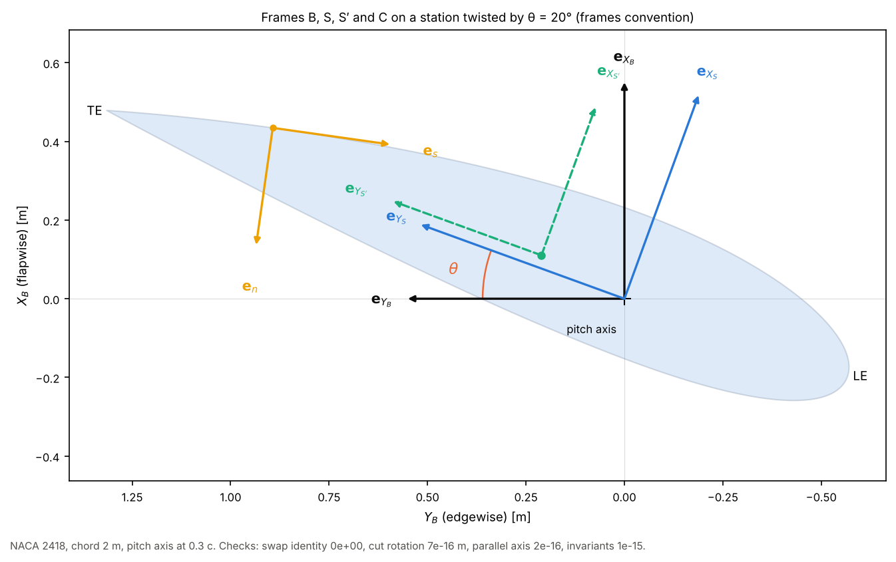

# 02 · The section frames on one twisted station

Figure R1.1 of the R manual: the blade frame B, the station frame S, the
centroidal station frame S′ and the contour frame C on a NACA 2418 station twisted
by θ = 20° in the `frames` convention. The derivations are in
[R1 · Coordinate frames and twist](../../../docs/r/R1_frames.md).



```bash
python examples/frames/02_frame_triad/frame_triad.py
```

The plot follows the section-plot convention: horizontal $Y_B$, vertical $X_B$,
horizontal axis inverted so that the leading edge is on the right. Only the display
is inverted; the stored coordinates are not negated.

## Checks

| # | Result | Equation | Largest error |
|---|---|---|---|
| 1 | Swapping components reverses the rotation: $\mathbf{P}\mathbf{Q}(\theta)\mathbf{P}=\mathbf{Q}(-\theta)$ | (R1.10) | 0 (exact) |
| 2 | A `BladeGeometry` cut at twist τ is the untwisted cut rotated by $\mathbf{Q}(\tau)$ in its own $(x, y)$ order | (R1.12) | 6.7e-16 m at τ = ±10°, ±20° |
| 3 | Parallel-axis relations between S and S′ | (R1.24) | 2.0e-16 of $I_{xx}+I_{yy}$ |
| 4 | $I_{xx}+I_{yy}$ and $I_{xx}I_{yy}-I_{xy}^2$ unchanged by S → B | (R1.22) | 9.9e-16 (relative) |
