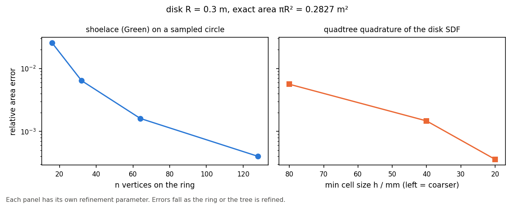

# 01 · Quadtree versus shoelace

A circular disk: exact \(\pi R^2\), Green’s theorem on a sampled ring, and
adaptive quadtree quadrature of the SDF. `SectionGeometry` properties use the
same backends for wall solids.

```bash
python examples/integration/01_quadtree_vs_shoelace/quadtree_vs_shoelace.py
```


