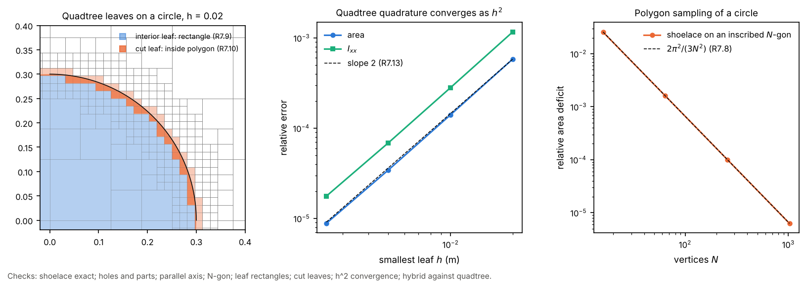

# 02 · Property quadrature

Figure R7.1 of the R manual: the leaves of the quadtree on a circle, the $h^2$
convergence of area and second moment, and the area deficit of an inscribed
polygon. The derivations are in
[R7 · Section properties by quadtree and shoelace integration](../../../docs/r/R7_section_properties.md).



```bash
python examples/integration/02_property_quadrature/property_quadrature.py
```

## Checks

| # | Result | Equation | Largest error |
|---|---|---|---|
| 1 | Shoelace sums of a rectangle off the origin and of a triangle against closed forms | (R7.1)–(R7.5) | $2\times10^{-16}$ |
| 2 | A hole subtracts; two disjoint parts add about the common origin | (R7.6) | exact |
| 3 | Centroidal moments equal the moments of the polygon moved to its centroid | (R7.7) | $6\times10^{-17}$ |
| 4 | Inscribed $N$-gon area exact; deficit falls by 16.00 per doubling of $N$ | (R7.8) | exact; ratio 16.00 |
| 5 | Area, first, second and product moments of an interior leaf | (R7.9) | exact |
| 6 | Cut leaves with one, two and three inside corners on straight boundaries | (R7.10) | exact |
| 7 | Quadtree circle: area and $I_{xx}$ converge with slope 2.02; $I_{xy}$ of an off-axis circle at round-off | (R7.12), (R7.13) | slope 2.02 |
| 8 | Hybrid against quadtree on the walls of a `2D-F` section | (R7.14) | $1.2\times10^{-3}$ relative |
