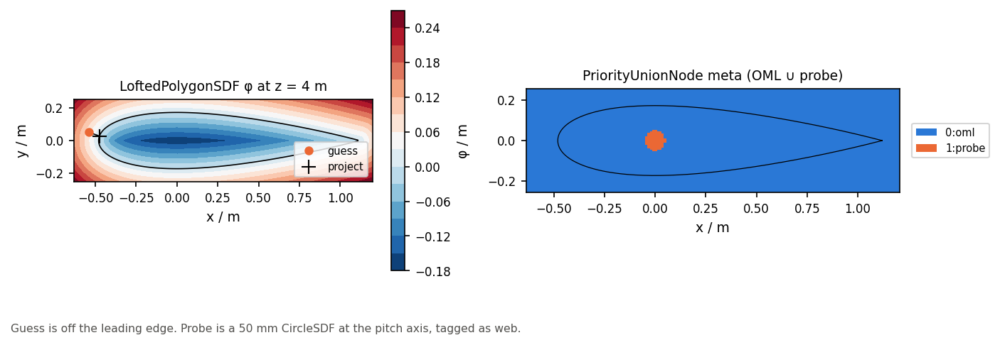

# 02 · Tagged 2.5-D feature field

`LoftedPolygonSDF` is the exact station polygon at each point’s \(z\).
`TagNode` / `PriorityUnionNode` stamp integer ids from a `FeatureTable`.
`GeometrySolver` projects in the section plane.

```bash
python examples/sdf/02_feature_field_loft/feature_field_loft.py
```



Related: [blade/10](../../blade/10_loft_oracles/).
