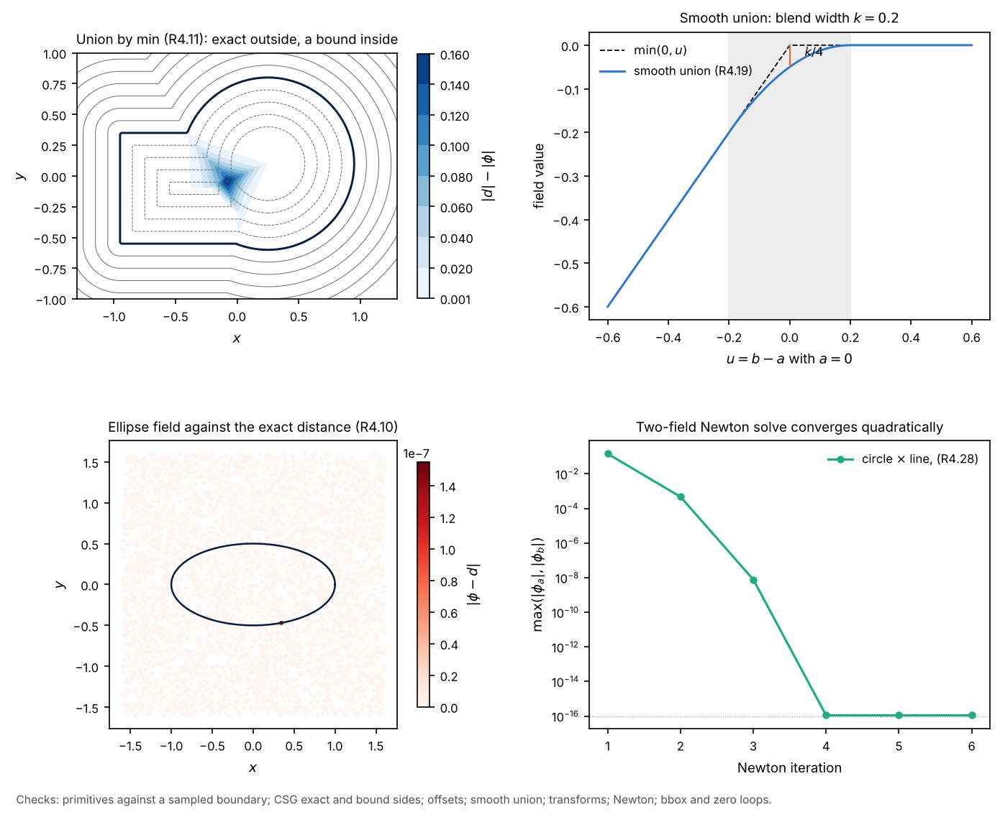

# 03 · Signed distance, CSG and Newton on fields

Figure R4.1 of the R manual: what a union field keeps of the distance, the smooth
union against `min`, the ellipse field against the exact distance, and the Newton
solve for the crossing of two zero sets. The derivations are in
[R4 · Signed distance fields and constructive solid geometry](../../../docs/r/R4_sdf_csg.md).



```bash
python examples/sdf/03_distance_and_csg/distance_and_csg.py
```

The reference distances are the distance to a boundary sampled at $4\times10^5$
points (a k-d tree query), so agreement is limited by that spacing, about
$10^{-5}$ of the shape size.

## Checks

| # | Result | Equation | Largest error |
|---|---|---|---|
| 1 | Circle, box, rounded box, oriented box, capsule, star polygon and half-plane against the sampled distance | (R4.3)–(R4.9) | $4.6\times10^{-6}$ (sampling) |
| 1 | Ellipse against the sampled distance (fixed in SD-001) | (R4.10) | $1.2\times10^{-7}$ |
| 2 | Union, intersection and difference of a disk and a box: exact on one side, a bound with the right sign on the other | (R4.11)–(R4.13) | $2.8\times10^{-6}$; ratio $\le 1$ |
| 2 | A min/max/offset tree is 1-Lipschitz | (R4.14) | ratio 1.000000 |
| 3 | Dilation, erosion and shell of an L-shaped polygon against level sets built from its edges and corners | (R4.15)–(R4.17) | $3.0\times10^{-7}$ |
| 4 | Smooth union: min beyond the band, $k/4$ below at $a = b$, 1-Lipschitz, slope continuous | (R4.19)–(R4.21) | $0$; $k/4$ to $10^{-12}$ |
| 5 | Rigid motions and uniform scaling exact; anisotropic scaling a bound | (R4.22), (R4.23) | $0$ |
| 6 | One Newton step lands on a circle; the circle-line crossing converges quadratically | (R4.27), (R4.28) | $4.0\times10^{-10}$; $10^{-16}$ in 4 steps |
| 7 | The box of an offset of two disjoint boxes contains its region (fixed in SD-002); two close circles extract as two loops (fixed in SD-003) | (R4.29)–(R4.31) | exact |
