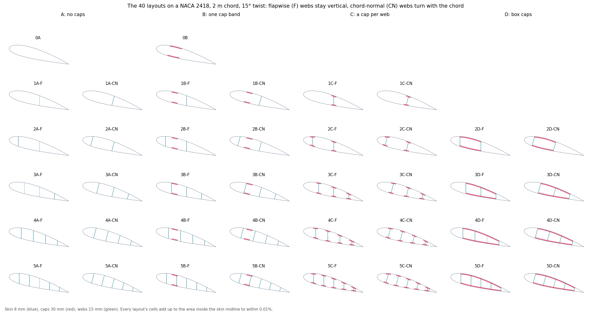

# 01 · The 40 structural layouts

Every layout the kernel knows, cut from the same twisted airfoil, with a consistency
check of each cut.



```bash
python examples/section/01_layout_catalogue/layout_catalogue.py
```

## Reading a layout key

A key reads `[W][X]-[Y]-[Z]-[R]`:

| Part | Values |
|---|---|
| webs | 0 to 5 shear webs at the layout's default chord fractions (`web_positions` overrides them) |
| cap family | **A** no spar caps · **B** one cap band across the webs · **C** a discrete cap on each web · **D** a continuous box cap between the outer webs (two or more webs) |
| orientation | **F** webs stay flapwise, normal to the rotor plane, as the section twists · **CN** webs stay normal to the chord and turn with it |
| anchoring | **LC** local chord fractions · **LE** metres from the leading edge · **PA** metres from the pitch axis |
| ribs | **0R** none · **nR** *n* transverse faces |

`0A` (skin only) and `0B` (caps, no webs) complete the 40. There is no `1D`: a box cap
needs two webs.

```python
from implicit_geometry_kernel import SYSTEM_TYPE_KEYS, BladeGeometry, resolve_system_type

spec = resolve_system_type("2D-F-LC-0R")      # n_webs 2, n_cells 3, has_spar_caps True
cut = BladeGeometry(stations, "2D-F-LC-0R", 0.008, pivot_fraction=0.3, spar_cap_thickness=0.03,
                    shear_web_thickness=0.015).section_at(0.5)
```

## The model

| Item | Value |
|---|---|
| Airfoil | NACA 2418, 2 m chord, pitch axis at 0.3 c, 15° twist |
| Walls | skin 8 mm, caps 30 mm, webs 15 mm |

The twist is there so that the F and CN variants differ: at 15° the F webs are still
vertical and the CN webs lean with the chord.

## Checks

For every one of the 40 cuts:

- the number of webs equals the spec's `n_webs`, the number of cells its `n_cells`
  (always `n_webs + 1`), and caps are present exactly when `has_spar_caps` is set;
- the cells tile the region inside the skin midline. Their areas add up to 0.47402 m²
  for every layout, against 0.47405 m² for the outer mould line offset inward by half
  the skin thickness (Shapely): within 0.006 %, whatever the webs and caps.

| Layout | Webs | Caps | Cells | Cell area [m²] |
|---|---|---|---|---|
| 0A | 0 | 0 | 1 | 0.47402 |
| 0B | 0 | 2 | 1 | 0.47402 |
| 1C-F | 1 | 2 | 2 | 0.47402 |
| 2D-F | 2 | 2 | 3 | 0.47402 |
| 5C-F | 5 | 10 | 6 | 0.47402 |

The full table, with each layout's description, is printed by the script.
