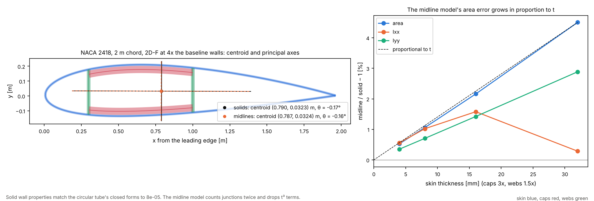

# 02 · Areas and second moments of the walls

Two ways to get a section's area and second moments: integrate the exact wall solids,
or idealise each wall as its midline times its thickness. This example checks the
solids against closed forms and measures what the thin-walled idealisation costs.



```bash
python examples/section/02_section_properties/section_properties.py
```

## The two routes

```python
from implicit_geometry_kernel import Airfoil
from implicit_geometry_kernel.section import SectionGeometry, resolve_system_type

result = SectionGeometry(layout=resolve_system_type("2D-F-LC-0R"),
                               airfoil=Airfoil.naca4("2412").to_sdf(chord=2.0),
                               skin_thickness=0.004, spar_cap_thickness=0.012, shear_web_thickness=0.006,
                               outputs=("properties",)).execute().get_results()
result.properties_map["spar_cap_suction_surface"]   # area, cx, cy, Ixx, Iyy, Ixy (about its own centroid)
```

`properties_map` holds one entry per wall solid (skins, caps, webs), plus the cavities
between them as `sandwich_core_*`. Coordinates are in the section frame: x from the
leading edge along the chord.

The thin-walled route uses `BladeGeometry.section_at(z).walls`: each wall's midline with
its thickness. Its integrals are exact for straight segments (the script sums
t ∫ y² ds segment by segment) but drop the t³/12 terms and count each junction twice: a
web midline runs to the skin midline, while the solid web stops at the skin's inner face.

## Circular tube against closed forms

D = 1 m, 10 mm skin (layout 0A), then with two 10 mm webs (2A-F):

| Quantity | Solid | Closed form | Error |
|---|---|---|---|
| skin area [m²] | 3.110174e-02 | π(R² − r²) = 3.110177e-02 | −8.2e-07 |
| skin Ixx [m⁴] | 3.810729e-03 | π(R⁴ − r⁴)/4 = 3.810744e-03 | −4.0e-06 |
| web at x/c = 0.15, area [m²] | 6.858052e-03 | strip of the inner circle 6.858581e-03 | −7.7e-05 |
| web at x/c = 0.50, area [m²] | 9.799814e-03 | 9.799830e-03 | −1.6e-06 |

The webs are compared with the vertical strip of the inner circle they fill, so the
reference includes the curvature of the skin's inner face at their ends.

## NACA 2418 with box caps: solids against midlines

2 m chord, 2D-F, walls scaled from a baseline of 4 mm skin, 12 mm caps and 6 mm webs:

| Scale | Skin [mm] | Area, solid [m²] | Area error | Ixx error | Iyy error | Principal axis, solid / midline |
|---|---|---|---|---|---|---|
| 1 | 4 | 0.036958 | +0.52 % | +0.56 % | +0.35 % | −0.21° / −0.21° |
| 2 | 8 | 0.073226 | +1.06 % | +1.02 % | +0.70 % | −0.20° / −0.19° |
| 4 | 16 | 0.143690 | +2.16 % | +1.58 % | +1.42 % | −0.17° / −0.16° |
| 8 | 32 | 0.276260 | +4.50 % | +0.29 % | +2.89 % | −0.13° / −0.09° |

- The midline model overestimates the area in proportion to the wall thickness:
  doubling the walls doubles the error (ratio 2.02 from scale 1 to 2). The excess is the
  junctions counted twice.
- Ixx errs less at the thickest walls because the dropped t³ terms and the doubled
  junctions start to cancel; that is luck, not accuracy.
- The centroid and principal axis barely move: the overlap is spread around the section.

Below a scale of 1 the solids would reach `section`'s minimum wall thicknesses (2.5 mm
skin, 4 mm web, 5 mm cap), so the sweep starts there. `BladeGeometry` avoids those
floors by building thinner sections at a larger scale and scaling back.
