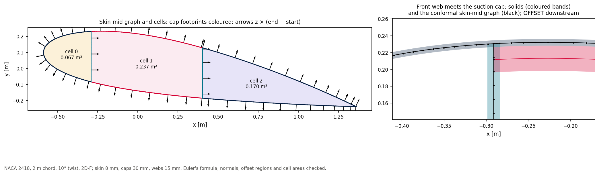

# 03 · Wall midlines, the conformal mid-surface and the cells

What a `SectionCut` hands to a shell mesher or a thin-walled beam model, and the checks
that make it safe to use.



```bash
python examples/section/03_mid_surface_and_cells/mid_surface_and_cells.py
```

## Three views of one section

```python
cut = BladeGeometry(stations, "2D-F-LC-0R", 0.008, pivot_fraction=0.3, spar_cap_thickness=0.03,
                    shear_web_thickness=0.015).section_at(0.5)
cut.walls          # SectionWall: label, kind, side, midline points, thickness, cap-skin bonds
cut.cells          # CellPolygon: closed polygon on the midlines, area, labels of its walls
ms = cut.mid_surface()   # MidSurface: points and oriented segments on the skin mid
g = cut.shell_graph()    # loftable loop partitions + webs; g.offset_regions()
```

| View | What it holds |
|---|---|
| `walls` | One midline per wall. Skins are split into bays at the webs (`skin_suction_surface:bay_0`); each cap lists the skin vertices it is bonded to. Caps stay on this list (solids). |
| `cells` | The closed cells, each with its area and the walls around it. Thin-walled torsion (Bredt-Batho) needs exactly this. |
| `mid_surface()` / `shell_graph()` | One conformal skin-mid loop. A cap is a partition (`layers = (cap, skin)`), mesh thickness `t_skin`, eccentricity `t_cap/2` for consumer OFFSET. `kind` on segments is only `skin` or `web`. **Loft** this graph; **snap** with `wall_mid_sdf`. |

## Checks

On a NACA 2418, 2 m chord, 10° twist, 2D-F (skin 8 mm, caps 30 mm, webs 15 mm):

| Check | Result |
|---|---|
| Euler's formula for a connected plane graph: cells = segments − nodes + 1 | holds |
| Nodes of degree 3 are the web-skin junctions | 4 = 2 per web |
| Every web borders two cells, every skin bay one | yes |
| Laminate normal z × (end − start) out of the section on skins, towards the TE on webs | all segments |
| Cap partitions lie on the skin midline; `offset_regions()` carry `t_cap/2` | two regions |
| Each cell's area equals the shoelace area of its polygon | to 1e-9 |

## Reading the junction

The right panel zooms on the front web where it meets the suction cap. Coloured bands
are **solids** (`cut.walls`). The black graph is the **mesh**: one skin-mid loop, no
cap-end kink. Downstream constitutives apply OFFSET only on `offset_regions()`.
[02_section_properties](../02_section_properties/) is the solids-properties twin.
