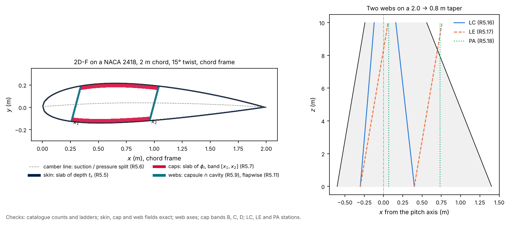

# 04 · From a layout key to walls

Figure R5.1 of the R manual: the walls of a `2D-F` section in the chord frame, and
the web stations of the three spanwise anchorings on a tapered planform. The
derivations are in
[R5 · Section layout](../../../docs/r/R5_section_layout.md).



```bash
python examples/section/04_layout_construction/layout_construction.py
```

## Checks

| # | Result | Equation | Largest error |
|---|---|---|---|
| 1 | 40 cores and 120 keys equal the set built from the grammar; malformed keys refused | (R5.1), (R5.2) | exact |
| 2 | Step-down ladders from 5A, 5B, 5C and 5D; cap run-out | (R5.3) | exact |
| 3 | Default web stations for one to five webs | (R5.4) | exact |
| 4 | Skin, cap and web fields along exact normals; web feet on the inner mould line | (R5.5)–(R5.10) | $6.2\times10^{-17}$ m |
| 5 | Flapwise web axes lean by the twist; chord-normal axes vertical | (R5.11) | $3.1\times10^{-16}$ rad |
| 6 | Cap bands of families D, C and B | (R5.13)–(R5.15) | $10^{-12}$ m |
| 7 | LC, LE and PA web stations on a 2.0 to 0.8 m taper; PA lattice | (R5.16)–(R5.18) | $2.2\times10^{-16}$ m |
