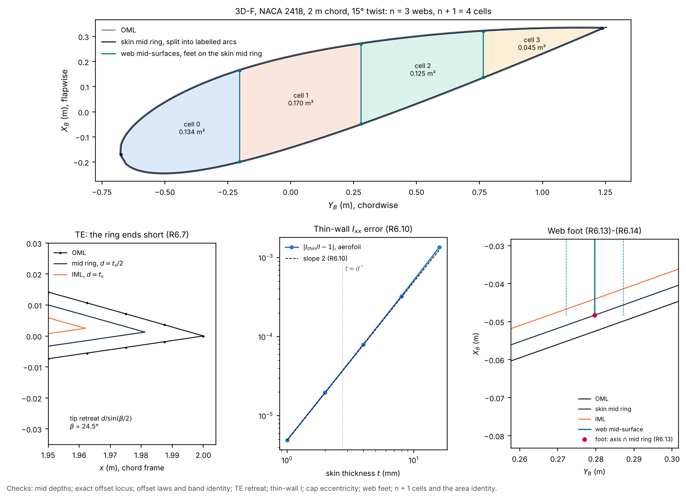

# 05 · Mid-surfaces, cells and the thin-wall idealisation

Figure R6.1 of the R manual: the skin mid ring and web mid-surfaces of a `3D-F`
section and the cells they bound, the end of the ring at the trailing edge, the
thin-wall second moment error, and a web foot. The derivations are in
[R6 · Mid-surfaces, cells and the thin-wall idealisation](../../../docs/r/R6_midsurfaces_cells.md).



```bash
python examples/section/05_midsurfaces_cells/midsurfaces_cells.py
```

## Checks

| # | Result | Equation | Largest error |
|---|---|---|---|
| 1 | Mid-surface depth for the four reference faces | (R6.1) | exact |
| 2 | Skin mid ring at distance $t/2$ from the outer mould line; no reflex vertex | (R6.2) | $8\times10^{-17}$ m |
| 3 | Offset length and area laws below $d^*$; band area equals $t L_m$ for $t \le d^*$ | (R6.3)–(R6.6) | $7\times10^{-15}$ m²; $1.1\times10^{-12}$ relative |
| 4 | Mid ring ends $d/\sin(\beta/2)$ from a sharp trailing edge | (R6.7) | $10^{-9}$ relative |
| 5 | Band second moment exact on a circle; thin-wall error on the aerofoil grows as $t^2$ | (R6.9), (R6.10) | $10^{-14}$ relative; slope 2.01 |
| 6 | Cap mid-surface at $t_s + h/2$; cap runs carry $t_s$ and eccentricity $h/2$ | (R6.11), (R6.12) | $4\times10^{-17}$ m |
| 7 | Web feet on the skin mid ring; reach past the inner mould line $t_s/(2\cos\gamma)$ | (R6.13), (R6.14) | $6\times10^{-17}$ m; $10^{-3}$ relative |
| 8 | $V = 2n + 2$, $E = 3n + 2$, $n + 1$ cells for $n = 0$ to 5; cell areas sum to the ring's | (R6.15)–(R6.17) | $2\times10^{-14}$ relative |
