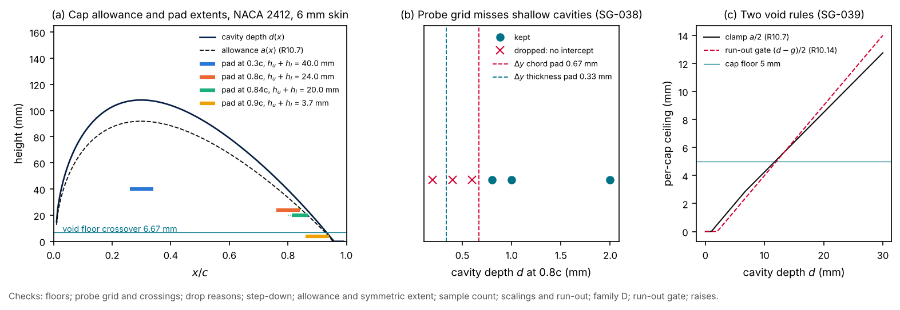

# 06 · Feasibility, drops and failure modes

Figure R10.1 of the R manual: the cap allowance along a NACA 2412 with four cap pads,
the probe grid that decides whether a web finds the cavity, and the two void rules of
the cap clamp and the run-out gate. The derivations are in
[R10 · Feasibility, drops and failure modes](../../../docs/r/R10_feasibility.md).



```bash
python examples/section/06_feasibility_checks/feasibility_checks.py
```

## Checks

| # | Result | Equation | Largest error |
|---|---|---|---|
| 1 | Skin, web and cap floors of 2.5, 4 and 5 mm; a skin under 1.25 mm raises (SG-040) | (R10.1) | exact; $10^{-9}$ m |
| 2 | A web is kept exactly when a probe sample lies in the cavity; 0.4 and 0.6 mm cavities dropped (SG-038) | (R10.2), (R10.3) | exact |
| 3 | Refined crossings within $2^{-m}\Delta y$ | (R10.4) | $4\times10^{-18}$ m |
| 4 | Merged, too shallow and no-intercept drops, in order | (R10.5) | exact |
| 5 | 2D-F to 1C-F, 3D-F to 2D-F; no web raises | (R10.6) | exact |
| 6 | Full, trimmed (symmetric) and scaled pads | (R10.7), (R10.9), (R10.11) | $10^{-12}$ m |
| 7 | Clip sample counts for four band widths | (R10.8) | exact |
| 8 | Global height scale; pad run-out | (R10.10), (R10.12) | $10^{-12}$ |
| 9 | Family D caps limited to half the aft depth | (R10.13) | exact |
| 10 | Run-out gate $(d - g)/2$ against the clamp (SG-039); fixed band centre (SG-041) | (R10.14) | $10^{-15}$ m |
| 11 | Flapwise web along the chord and an unresolved drop raise | Section 3.11 | – |
