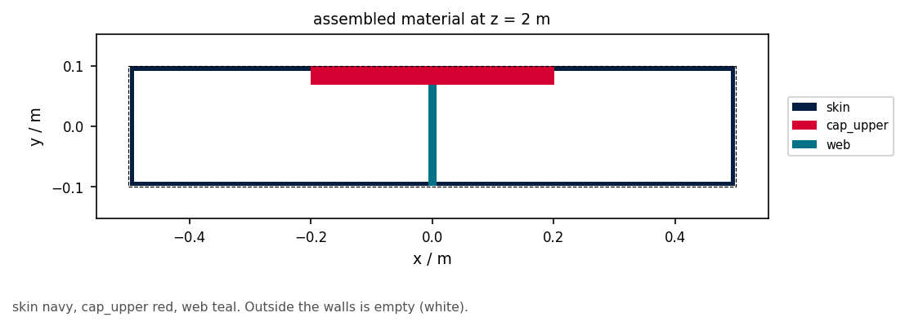

# 03 · Assemble a box beam

The `structure` package (not loft `Stringer` / `TransverseMember`) combines
wall, branch, region, and transverse contributions into SDF fields.

```bash
python examples/structure/03_assemble_box_beam/assemble_box_beam.py
```



Related: [01 transverse rib](../01_transverse_rib/) (loft graph faces).
