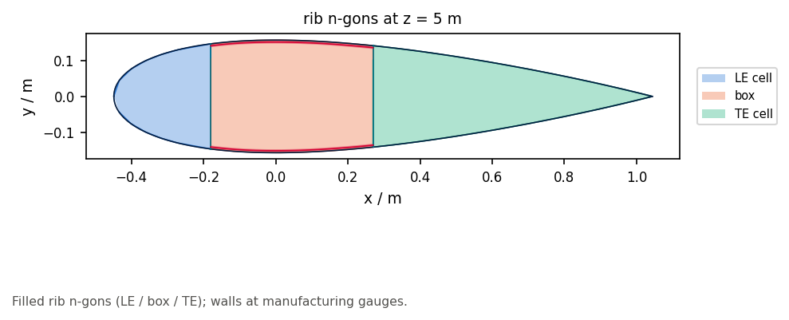

# 04 · Partition edges and rib faces

Beyond [01](../01_transverse_rib/): `rib_face_polygons` from the mapped loft,
and `partition_edge_curve` along a named pair of shell runs.

```bash
python examples/structure/04_partition_rib_faces/partition_rib_faces.py
```


