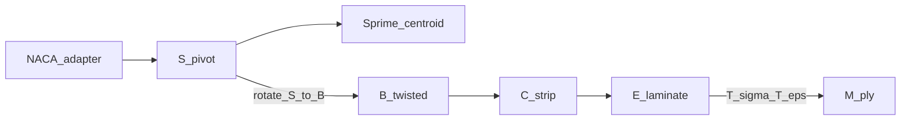

# Coordinate frames

Single source of truth for structural frames **R / B / S / S′**, the shell
**curvilinear** strip basis **C**, and the shell **element** / ply frames
**E** / **M**.

Homes follow **Mathematics**, **Key equations → functions**, **Exact I/O**,
and **Provenance / what happens today** — same idea as
[`section_geometry`](../section_geometry/README.md) /
[`section_mesh`](../../mesh_utilities/section_mesh/README.md).

Always use these explicit names — avoid bare “local/global” and “strip local”.

**Import rule:** `from blade_structure_utilities.geometry_utilities.coordinate_frames import …`
— never reimplement 2×2 twist, NACA pivot, or flap↔`My`/`Mz` outside these homes.

## Contents

1. [Abstract and ownership](#1-abstract-and-ownership)
2. [Frame inventory](#2-frame-inventory)
3. [Who carries twist](#3-who-carries-twist)
4. [Ownership homes](#4-ownership-homes)
5. [Quick start](#5-quick-start)
6. [Verification](#6-verification)
7. [Package layout](#7-package-layout)
8. [See also](#8-see-also)

---

## 1. Abstract and ownership

| | |
|---|---|
| **Owns** | Short tags (`FrameTag` / `FRAME_*` / `require_frame_tag`); axis sense and plot contract for B/S/S′; S↔B geometry/moment/inertia maps; NACA↔S adapter; section-plot helpers; E↔M ply \(T_\sigma/T_\varepsilon\) (in-plane 3×3 and canonical 6×6); product shell load-channel adapter |
| **Does not own** | SDF solids, strip meshing, MITC4 kinematics, Hashin FI evaluation, formulation projectors |
| **Consumers** | `section_contract` (B midlines / `BeamResultantVector` frame tags), `section_geometry` (S authoring / B emit), `section_mesh` (+x3 / B midlines), FE tertiary/quaternary, beam `StressHistory`, root_blend adapters, BIS nests / BSP assemble scratch |

---

## 2. Frame inventory

| Frame | Role | Axes | One-liner |
|-------|------|------|-----------|
| **R** | Turbine span metadata | \(r\), \(r/R\) | Not a section XYZ |
| **S** (`zero_twist_pitch_axis_station_frame`) | Zero-twist station / authoring | \(X_S,Y_S,Z_S\) | Origin on pitch axis; plot: horiz \(Y_S\), vert \(X_S\), invert horiz (LE on RHS) |
| **S′** (`zero_twist_centroid_axis_station_frame`) | Same as S; origin on centroid axis | \(X_{S'},Y_{S'},Z_{S'}\) | Same plot recipe as S; parallel-axis / fibre depth |
| **B** (`twisted_pitch_axis_blade_frame`) | Twisted blade outline + resultants | \(X_B,Y_B,Z_B\) | Same plot recipe as S; midlines / FE mesh live here |
| **C** | Curvilinear strip (MITC4 DOFs) | \(x,s,n\) | Attached to **B** midlines; not a section plot frame |
| **E** | Element / laminate (same frame) | \(x_1,x_2,x_3\) | C≡E on each flat MITC4 facet |
| **M** | Ply material (fibre) | \(1,2,3\) | E rotated in-plane by ply θ; **FI only in M** |



---

## 3. Who carries twist

- **S** and **S′**: chord-aligned, **zero-twist** section view. Not aware of twist along \(Z_S\).
- **B**: DNV blade axes; the **section outline in B** is the S outline rotated by geometric twist about \(Z\).
- Twist appears only in **S ↔ B** maps (geometry rotate, moment / force / inertia transform).

(Older wording “B fixed / S rotates” described the same polarity from the opposite narrative. Prefer S = zero-twist / B = twisted-outline.)

---

## 4. Ownership homes

| # | Home | Owns |
|---|------|------|
| 0 | [`frame_tags.py`](frame_tags.py) | Canonical short tags `FrameTag` / `FRAME_*` / `require_frame_tag` for structural dataclass fields |
| 1 | [`section_frames/README.md`](section_frames/README.md) | Shared B/S/S′ storage + plot contract; NACA adapter; S↔B; Exact I/O for geometry helpers |
| 2 | [`shell_frames/README.md`](shell_frames/README.md) | C / E / M axes; C≡E; \(T_\sigma\) / \(T_\varepsilon\); FI-in-M; Exact I/O for ply transforms |

**Container tagging.** Structural `frame` / `*_frame` fields on dataclasses across `src` should use `FrameTag` and validate with `require_frame_tag` at construction or finalize. Prefer `FRAME_B` (etc.) over bare string literals. Containers carry tags only — they must not reimplement S↔B / E↔M.

Operational demos (demos / plots): [`visualisation/`](visualisation/README.md).

Known-issue / package inventory: [`FRAMES_INVENTORY.md`](FRAMES_INVENTORY.md)
(programme status for ARCH-MUST-016 remediation).

---

## 5. Quick start

```python
from blade_structure_utilities.geometry_utilities.coordinate_frames import (
    CoordinateFrameTransforms,
    blade_resultants_to_shell_channels,
    naca_to_twisted_pitch_axis_blade_frame,
    section_plot_axes,
    setup_section_axes,
)

# NACA → canonical B (pivot + twist)
pts_B = naca_to_twisted_pitch_axis_blade_frame(verts_naca, twist_rad, chord_m)

# Section plot: horizontal Y_*, vertical X_*, invert for LE on RHS
h, v = section_plot_axes(pts_B)
# ax.plot(h, v); setup_section_axes(ax)

# S → B second moments (θ = geometric twist; S outline is zero-twist)
transform = CoordinateFrameTransforms()
I_xx_B, I_yy_B, I_xy_B = transform.transform_second_moments_S_to_B(
    I_xx_S, I_yy_S, I_xy_S, twist_deg
)

# Structural flap/edge → product shell FE solver channels (adapter)
ch = blade_resultants_to_shell_channels(
    M_flapwise=1.0, M_edgewise=0.0, V_flapwise=0.0, V_edgewise=0.0
)
```

```python
from blade_structure_utilities.geometry_utilities.coordinate_frames import (
    rotate_ply_stress_E_to_M,
    rotate_ply_strain_E_to_M,
)

# E → M: stress and strain use DIFFERENT matrices — see shell_frames
sigma_M = rotate_ply_stress_E_to_M(sigma_E, ply_angles_deg)
eps_M = rotate_ply_strain_E_to_M(eps_E, ply_angles_deg)

# Canonical 3D Voigt [11,22,33,23,13,12]
from blade_structure_utilities.geometry_utilities.coordinate_frames import (
    rotate_ply_stress_3d_E_to_M,
    rotate_transverse_shear_E_to_M,
)
```

---

## 6. Verification

| Claim | Evidence |
|-------|----------|
| Shared B/S/S′ plot contract (LE on RHS, \(+Y\)→TE) | [`visualisation/demos/plot_structural_frames.py`](visualisation/demos/plot_structural_frames.py) → `visualisation/output/structural_frames_B_S_Sprime.png` |
| `naca_to_twisted_pitch_axis_blade_frame` / `section_plot_axes` | Unit coverage + geometry/mesh demos |
| E↔M stress vs strain matrices | `tests/test_ply_frame_transforms.py` |
| Product load channels | `blade_resultants_to_shell_channels` call sites in BSP / BSF |

```bash
python -m blade_structure_utilities.geometry_utilities.coordinate_frames.visualisation.demos.plot_structural_frames
```

---

## 7. Package layout

```text
coordinate_frames/
├── README.md                 # package index
├── FRAMES_INVENTORY.md       # classification / known issues
├── frame_tags.py             # short-tag SoT (FrameTag / FRAME_* / require_frame_tag)
├── section_frames/           # home 1 — B / S / S′
├── shell_frames/             # home 2 — C / E / M
├── visualisation/            # demos + output (demos / plots)
└── tests/
```

---

## 8. See also

- [`section_frames/README.md`](section_frames/README.md)
- [`shell_frames/README.md`](shell_frames/README.md)
- [`visualisation/README.md`](visualisation/README.md)
- Handoff DTOs that speak B: [`../section_contract/README.md`](../section_contract/README.md) (ABI-shaped geometry→mesh/load/FE vocabulary)
- Element recovery: [compute_tertiary docs](../../fem_utilities/section_shell_fea/processing/static/results/compute_tertiary/docs/README.md)
- Quaternary FI: [compute_quaternary docs](../../fem_utilities/section_shell_fea/processing/static/results/compute_quaternary/docs/README.md)
- Root blend S/B adapters: `geometry_utilities/root_blend_model/adapters.py`
- Shell station load map: BSP `shell_station/evaluate.py` (uses `blade_resultants_to_shell_channels`)
