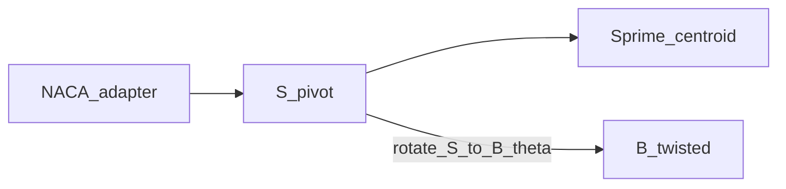

# Section frames B, S, S′

↑ Parent: [`../README.md`](../README.md) · Shell frames: [`shell_frames_CEM.md`](shell_frames_CEM.md)

## Table of contents

1. [Purpose / ownership](#purpose--ownership)
2. [Mathematics — shared contract](#mathematics--shared-contract)
3. [Per-frame differences](#per-frame-differences)
4. [NACA adapter (not a frame)](#naca-adapter-not-a-frame)
5. [S ↔ B rotation](#s--b-rotation)
6. [Key equations → functions](#key-equations--functions)
7. [Exact I/O](#exact-io)
8. [Provenance / what happens today](#provenance--what-happens-today)
9. [Figures](#figures)
10. [See also](#see-also)

---

## Purpose / ownership

| Owns | Does **not** own |
|------|------------------|
| Axis sense, storage order, and **section plot** recipe for **B, S, S′** | Curvilinear strip **C**, laminate **E**, ply **M** ([shell home](../shell_frames/README.md)) |
| NACA ↔ S; S ↔ B geometry maps; plot helpers | SDF solids, strip mesh density |
| Moment / inertia S↔B polarity documentation | Product FE `My`/`Mz` channel names (adapter on parent quick start) |

---

## Mathematics — shared contract

The following rules apply **identically** to **B**, **S**, and **S′**. Only origin and twist differ (next section).

View the section looking along \(+Z\) (root → tip) with \(+X\) up:

| Rule | Statement |
|------|-----------|
| **Storage order** | Points are \((X_*,\, Y_*)\) — **not** \((Y,\, X)\) |
| \(+X_*\) | Up on the section (flapwise in B; chord-normal in S/S′) |
| \(+Y_*\) | Toward the **trailing edge** |
| **Data Y sense** | \(Y_{\mathrm{LE}} < 0 < Y_{\mathrm{TE}}\) at the frame origin (pivot or centroid). Equivalently \(Y_{\mathrm{LE}} < Y_{\mathrm{TE}}\) with LE on the negative-\(Y\) side |
| **Plot** | Horizontal \(= Y_*\), vertical \(= X_*\); then **invert the horizontal axis** (display-only) so the LE appears on the **RHS**. Aerofoil section figures finish with a **square** data window and square axes box via `fit_square_section_axes` |
| **Forbidden** | Negating stored \(Y\) to “put LE on the right” — that silently breaks every geometric test |

Right-handed triad looking along \(+Z\): \(+X\) up, \(+Y\) toward TE (left on an uninverted screen). The plot invert restores LE-on-RHS readability without changing data.

**Same sense in B, S, and S′** is an axis-sense choice, not a second twist. With this polarity, positive geometric twist rotates the B outline into the installed blade attitude.


---

## Per-frame differences

| Frame | Origin | Twist | Typical use |
|-------|--------|-------|-------------|
| **S** | Pitch pivot (\(\approx 0.333\,c\) from LE) | Zero-twist outline | Authoring / IR / constructive midlines before handoff |
| **S′** | Section **centroid** (axes parallel to S) | Zero-twist | Fibre depth, parallel-axis / beam stress in S′ |
| **B** | Pitch pivot in blade-installed attitude | Outline = S rotated by geometric twist about \(Z\) | Shell midlines, FE mesh, B beam resultants |



Stiffness naming in B (reminder): \(\mathrm{EI}_{\mathrm{flap}} = E\,I_{yy,B}\) (bending about \(X_B\)); \(\mathrm{EI}_{\mathrm{edge}} = E\,I_{xx,B}\) (bending about \(Y_B\)).

---

## NACA adapter (not a frame)

Raw airfoil storage is NACA-like \((x_{\mathrm{chord}},\, y_{\mathrm{thickness}})\) with LE at \(x=0\). That pair is **not** S and **not** B.

\[
X_S = y_{\mathrm{thickness}},\qquad
Y_S = x_{\mathrm{chord}} - f_{\mathrm{pivot}}\, c
\]

with \(f_{\mathrm{pivot}} \approx 0.333\). Both the **component swap** and the **pivot shift** are required: swap puts chord-normal first (\(X\)); shift places the origin on the pitch axis so \(Y_{\mathrm{LE}} < 0 < Y_{\mathrm{TE}}\).

Do **not** plot raw NACA with the B/S recipe without
`naca_to_zero_twist_pitch_axis_station_frame` (or
`naca_to_twisted_pitch_axis_blade_frame` for B). Short aliases
`naca_to_S` / `chord_to_blade` remain for compatibility.

---

## S ↔ B rotation

On **canonical** \((X,Y)\) arrays, geometric twist \(\theta\) (radians) maps S → B as \(R(-\theta)\):

\[
X_B = \cos\theta\, X_S + \sin\theta\, Y_S,\qquad
Y_B = -\sin\theta\, X_S + \cos\theta\, Y_S.
\]

**Warning:** a legacy **swapped** \((Y,X)\) array needs the opposite matrix polarity for the same physical rotation (\(P R(+t) P = R(-t)\)). Passing swapped points into `rotate_S_to_B` rotates them the wrong way. Prefer remapping to canonical order; `rotate_S_to_B_swapped_order` exists only as a quarantine bridge.

Full geometry handoff NACA → B:

\[
\texttt{chord\_to\_blade}
= \texttt{rotate\_S\_to\_B}\circ\texttt{naca\_to\_S}.
\]

`rotate_S_to_B` alone on NACA vertices is **not** sufficient — it leaves a chordwise-first, LE-origin array.

---

## Key equations → functions

| Symbol / step | Function | Module |
|---------------|----------|--------|
| NACA → S | `naca_to_zero_twist_pitch_axis_station_frame` (`naca_to_S`) | `geometry.py` |
| S → NACA | `zero_twist_pitch_axis_station_frame_to_naca` (`S_to_naca`) | `geometry.py` |
| S → B (canonical) | `rotate_zero_twist_pitch_axis_station_frame_to_twisted_pitch_axis_blade_frame` (`rotate_S_to_B`) | `geometry.py` |
| B → S | `rotate_twisted_pitch_axis_blade_frame_to_zero_twist_pitch_axis_station_frame` (`rotate_B_to_S`) | `geometry.py` |
| Legacy swapped S → B | `…_swapped_order` (`rotate_S_to_B_swapped_order`) | `geometry.py` |
| NACA → B | `naca_to_twisted_pitch_axis_blade_frame` (`chord_to_blade`) | `geometry.py` |
| B → NACA | `twisted_pitch_axis_blade_frame_to_naca` (`blade_to_chord`) | `geometry.py` |
| Plot arrays \((h,v)=(Y,X)\) | `section_plot_axes` | `plot.py` |
| Labels + invert | `setup_section_axes` | `plot.py` |
| Square window + box | `fit_square_section_axes` | `plot.py` |
| Plot polyline | `plot_section_polyline` | `plot.py` |
| Section-plane \(+x_3\) normal | `section_normal_2d` | `plot.py` |
| Second moments S ↔ B | `CoordinateFrameTransforms.transform_second_moments_*` | `tensors.py` / `facade.py` |
| Moments B ↔ S | `CoordinateFrameTransforms.transform_moments_*` | `tensors.py` / `facade.py` |
| Default pivot fraction | `PIVOT_FRACTION_DEFAULT` | `geometry.py` |

---

## Exact I/O

### `naca_to_zero_twist_pitch_axis_station_frame(…)` (`naca_to_S`)

| | |
|---|---|
| **In** | NACA \((x_{\mathrm{chord}}, y_{\mathrm{thickness}})\), LE at \(x=0\); chord [m]; pivot fraction from LE |
| **Out** | Canonical S \((X_S, Y_S)\) |
| **Raises** | `ValueError` if not `(N, 2)` |

### `naca_to_twisted_pitch_axis_blade_frame(…)` (`chord_to_blade`)

| | |
|---|---|
| **In** | NACA verts; geometric twist [rad]; chord; pivot |
| **Out** | Canonical B \((X_B, Y_B)\) |
| **Side** | `naca_to_zero_twist_pitch_axis_station_frame` then S→B rotate |

### `twisted_pitch_axis_blade_frame_to_naca(…)` (`blade_to_chord`)

Inverse of `naca_to_twisted_pitch_axis_blade_frame`.

### `rotate_S_to_B(pts_S, twist_rad) → (N,2)`

| | |
|---|---|
| **In** | Canonical S points; twist [rad] |
| **Out** | Canonical B points |
| **Contract** | Arrays must already be \((X,Y)\) with \(+Y\)→TE |

### `section_plot_axes(pts_B) → (h, v)`

| | |
|---|---|
| **In** | Canonical B (or any \((X_*,Y_*)\) with the shared sense) |
| **Out** | `h = Y_*`, `v = X_*` for `ax.plot(h, v)` |
| **Pair with** | `setup_section_axes(ax)` then `fit_square_section_axes(ax)` for labels + LE-on-RHS invert + square panel |

### `setup_section_axes(ax, *, invert_for_le_on_rhs=True, …)`

| | |
|---|---|
| **In** | Matplotlib Axes |
| **Out** | Labels \(Y_B\) / \(X_B\) by default; optional invert; equal aspect |
| **Idempotent** | Will not double-invert |

Default label strings are B-oriented (`SECTION_PLOT_XLABEL` / `SECTION_PLOT_YLABEL`); for pure S figures pass `xlabel` / `ylabel` explicitly (same invert rule).

### `fit_square_section_axes(ax, *, pad_frac=0.08, box_aspect=1.0)`

| | |
|---|---|
| **In** | Matplotlib Axes with data already plotted |
| **Out** | Square data window (padded); square axes box when `box_aspect=1` |
| **Preserves** | Horizontal inversion (LE on RHS) |

Call after `setup_section_axes` for aerofoil section figures.

---

## Provenance / what happens today

| Claim | Status |
|-------|--------|
| Shared storage + plot contract for B/S/S′ | Canon in this home; helpers enforce plot remap |
| Midline emit uses `chord_to_blade` | Exact at geometry→shell handoff |
| Twisted `MultiCellSection[label](x,y)` query space | Still **rotated-NACA-about-LE** in places — **not** full B until a dedicated B-eval adapter; do not treat SDF query coords as B without mapping ([plot_subcomponents](../../section_geometry/visualisation/plot_subcomponents.py) documents the bridge) |
| `rotate_S_to_B_swapped_order` | Legacy quarantine; prefer canonical order |
| Negating \(Y\) for display | **Forbidden** |

---

## Figures

Regenerate:

```bash
python -m blade_structure_utilities.geometry_utilities.coordinate_frames.visualisation.demos.plot_structural_frames
```

Expected output: [`../visualisation/output/structural_frames_B_S_Sprime.png`](../visualisation/output/structural_frames_B_S_Sprime.png) — B / S / S′ panels with data \(+Y\)→TE and display invert (LE on RHS).

---

## See also

- Parent map: [`../README.md`](../README.md)
- Shell C/E/M: [`shell_frames_CEM.md`](shell_frames_CEM.md)
- Geometry chapter notation: [`../../section_geometry/README.md`](../../section_geometry/README.md) §2
- Known-issue index: [`../FRAMES_INVENTORY.md`](../FRAMES_INVENTORY.md)
