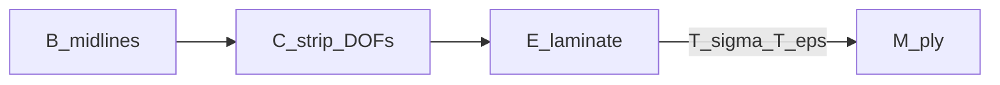

# Shell frames C, E, M

↑ Parent: [`../README.md`](../README.md) · Section frames: [`section_frames_BSS.md`](section_frames_BSS.md)

## Table of contents

1. [Purpose / ownership](#purpose--ownership)
2. [Mathematics — C (curvilinear strip)](#mathematics--c-curvilinear-strip)
3. [Mathematics — E (element / laminate)](#mathematics--e-element--laminate)
4. [Mathematics — M (ply material)](#mathematics--m-ply-material)
5. [Key equations → functions](#key-equations--functions)
6. [Exact I/O](#exact-io)
7. [Provenance / what happens today](#provenance--what-happens-today)
8. [See also](#see-also)

---

## Purpose / ownership

| Owns | Does **not** own |
|------|------------------|
| Naming and axis sense for **C**, **E**, **M** | Section-plane B/S/S′ storage/plot ([BSS home](../section_frames/README.md)) |
| C≡E on flat MITC4 facets; E↔M ply transforms | MITC4 stiffness assembly, Hashin evaluation internals |
| Stress vs strain transform distinction | Mesh density / strip Q4 discretisation |

Chain (geometry midlines already in **B**):

---

## Mathematics — C (curvilinear strip)

MITC4 nodal DOFs are written in the **curvilinear strip** basis that follows each
panel midline. Geometry for that midline is authored and stored in **B**.

| Axis / DOF | Role | Aligns with **E** |
|------------|------|-------------------|
| \(x\) / \(u_x\) | Spanwise (unit-slice beam axis) | \(x_1\) |
| \(s\) / \(u_s\) | Contour tangent along the midline | \(x_2\) |
| \(n\) / \(w\) | Shell normal (out-of-plane) | \(x_3\) |
| \(\beta_s,\beta_x\) | Mindlin rotations about \(s\) and \(x\) | — |
| \(\beta_\zeta\) | Drilling about \(n\) (MITC4+ only) | — |

**Handedness.** \((x,s,n)\) is right-handed. The section-plane normal that seeds
laminate \(+x_3\) / \(n\) is owned by `section_normal_2d` (90° CCW of contour
tangent on canonical \((X_B,Y_B)\)), enforced at mesh inputs by
`panel_x3_orientation`.

**Not a section plot frame.** Section figures stay in B/S with the shared
horiz-\(Y\) / vert-\(X\) / invert recipe ([BSS](../section_frames/README.md)). Do not
draw C axes as a second section XYZ.

**Alias ban.** Do **not** call **C** “local”, “strip local”, or “panel-local” in
new prose.

Parent \((\xi,\eta)\) are isoparametric natural coordinates on the element — **not**
a structural frame. Assembled FE “global DOF” indices are the station-mesh system
ordering, not frame **R**.

---

## Mathematics — E (element / laminate)

Shell element coordinates, resultants, and stresses live in \((x_1,x_2,x_3)\):

| Axis | Role |
|------|------|
| \(x_1\) | Strip / laminate longitudinal |
| \(x_2\) | Contour tangent |
| \(x_3\) | Through-thickness |

with \(\{N_{11},N_{22},N_{12},M_{11},M_{22},M_{12}\} \leftrightarrow \{\sigma_{11},\sigma_{22},\tau_{12}\}(x_3)\).

**C ≡ E on each flat MITC4 facet:** \(x\leftrightarrow x_1\), \(s\leftrightarrow x_2\),
\(n\leftrightarrow x_3\). Prefer **C** for kinematics / DOFs
\((u_x,u_s,w,\ldots)\); prefer **E** for resultants and stresses.

> **Naming:** “element frame” (shell model) and “laminate frame”
> (`material_utilities`) are **the same frame**. Names like `sig_lam` /
> `ply_face_stresses_laminate` and \(x_1,x_2,x_3\) refer to **E**. Only the
> ply-angle rotation leaves E.

**Owns in E:** \(\bar{Q}\), ABD, \(N/M\) resultants, `sig_lam` / `eps_lam`,
`ply_face_*_laminate`.

---

## Mathematics — M (ply material)

**M** is **E** rotated **in-plane about \(x_3\)** by that ply’s angle \(\theta\).
Axes remain \((1,2,3)\); direction **1** is the fibre. Each ply in a stack has
its own M.

**Failure criteria (Hashin, etc.) are only valid in M.** Feeding E-frame stress
to `hashin_fi` returns a wrong (usually far too low) index.

Voigt stress and engineering strain rotate with **different** matrices, because
\(\gamma_{12} = 2\varepsilon_{12}\):

\[
T_\sigma =
\begin{bmatrix}
c^2 & s^2 & 2sc \\
s^2 & c^2 & -2sc \\
-sc & sc & c^2-s^2
\end{bmatrix}
\qquad
T_\varepsilon =
\begin{bmatrix}
c^2 & s^2 & sc \\
s^2 & c^2 & -sc \\
-2sc & 2sc & c^2-s^2
\end{bmatrix}
\]

with \(c=\cos\theta\), \(s=\sin\theta\). Using \(T_\sigma\) on strain corrupts
\(\gamma_{12}\) and the normal strains whenever the laminate carries shear.
Inverses are the same builders at \(-\theta\).

Self-consistency check: \(\sigma_M = Q_{\mathrm{material}}\,\varepsilon_M\).

### What lives where

| Frame | Quantities |
|-------|------------|
| **E** | \(\bar{Q}\), ABD, \(N/M\), `sig_lam` / `eps_lam`, `ply_face_*_laminate` |
| **M** | Hashin strengths \((X_t,X_c,Y_t,Y_c,S_{12})\), `sig_ply_mat`, `eps_ply_mat` |

### Ply-angle sign

\(\theta\) is the rotation from laminate-1 to material-1; transform builders apply
\(+\theta\) as written above.

> **Tracked debt:** `_Q_bar_single` computes \(\bar{Q} = R\,Q\,R^{\mathsf{T}}\) with
> \(R = T_\sigma(\theta)\), which equals the standard \(\bar{Q}(-\theta)\) — so
> \(\bar{Q}\) and `T_ply` currently carry **opposite** angle signs.
> Self-consistency holds only under \(-\theta\). Max-FI is unaffected for balanced
> ±45 / quasi-iso stacks; **per-ply attribution is mirrored**. Fix both sides
> together — see [`../FRAMES_INVENTORY.md`](../FRAMES_INVENTORY.md).

---

## Key equations → functions

| Symbol / step | Function | Module |
|---------------|----------|--------|
| \(T_\sigma\) E→M | `ply_stress_transform_E_to_M` | `ply.py` |
| \(T_\varepsilon\) E→M | `ply_strain_transform_E_to_M` | `ply.py` |
| \(T_\sigma\) M→E | `ply_stress_transform_M_to_E` | `ply.py` |
| \(T_\varepsilon\) M→E | `ply_strain_transform_M_to_E` | `ply.py` |
| Apply \(T\) to vectors | `rotate_ply_vectors` | `ply.py` |
| Build+apply stress | `rotate_ply_stress_E_to_M` / `_M_to_E` | `ply.py` |
| Build+apply strain | `rotate_ply_strain_E_to_M` / `_M_to_E` | `ply.py` |
| Memoised laminate \(T\) | `lam.stiffness_bundle().T_ply` / `.T_ply_eps` | `material_utilities` |
| Section-plane \(+x_3\) | `section_normal_2d` | `section_frames.plot` |

---

## Exact I/O

### `ply_stress_transform_E_to_M(theta_deg) → ndarray`

| | |
|---|---|
| **In** | Ply angle(s) [deg], rotation about \(x_3\) from E to M |
| **Out** | \(T_\sigma\) with shape `theta.shape + (3, 3)` |
| **Contract** | Do **not** apply to engineering strain |

### `ply_strain_transform_E_to_M(theta_deg) → ndarray`

| | |
|---|---|
| **In** | Same θ convention |
| **Out** | \(T_\varepsilon\) with factor-2 shear terms |
| **Contract** | Do **not** apply to Voigt stress |

### `rotate_ply_stress_E_to_M(sigma_E, theta_deg) → sigma_M`

| | |
|---|---|
| **In** | `sigma_E` trailing dim 3 = \([\sigma_{11},\sigma_{22},\tau_{12}]\); θ broadcasts against `sigma_E.shape[:-1]` (e.g. `(n_ply, 1)` for `(n_ply, n_face, 3)`) |
| **Out** | Stress in M |

### `rotate_ply_strain_E_to_M(eps_E, theta_deg) → eps_M`

| | |
|---|---|
| **In** | `eps_E` trailing dim 3 = \([\varepsilon_{11},\varepsilon_{22},\gamma_{12}]\) |
| **Out** | Engineering strain in M |

Inverses: `*_M_to_E` builders use \(-\theta\).

Consumers holding a `LaminateDefinition` should prefer memoised
`lam.stiffness_bundle().T_ply` (stress) and `.T_ply_eps` (strain) over rebuilding.

---

## Provenance / what happens today

| Claim | Status |
|-------|--------|
| Element frame = laminate frame = **E** | Exact naming contract |
| C ≡ E on flat MITC4 facet | By construction |
| FI only in M | Product path rotates; some diagnostic CLPT paths historically skipped rotation — see inventory `bug_fix` rows |
| \(T_\sigma\) ≠ \(T_\varepsilon\) | Exact; tests in `tests/test_ply_frame_transforms.py` |
| \(\bar{Q}\) vs `T_ply` angle sign | **legacy_quarantine** — do not “fix” one side alone |
| Section figures in C | **Never** — use B/S plot contract |

---

## See also

- Parent map: [`../README.md`](../README.md)
- Section B/S/S′: [`section_frames_BSS.md`](section_frames_BSS.md)
- Tertiary recovery / faces: [compute_tertiary docs](../../../fem_utilities/section_shell_fea/processing/static/results/compute_tertiary/docs/README.md)
- Quaternary FI: [compute_quaternary docs](../../../fem_utilities/section_shell_fea/processing/static/results/compute_quaternary/docs/README.md)
- Mesh +x3 conventions: [`../../../mesh_utilities/section_mesh/handoff/README.md`](../../../mesh_utilities/section_mesh/handoff/README.md)
- Issue index: [`../FRAMES_INVENTORY.md`](../FRAMES_INVENTORY.md)

