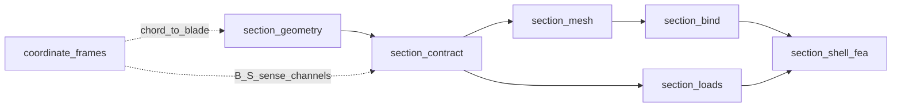

# section_contract — ABI-shaped handoff vocabulary

**Package:** `blade_structure_utilities.geometry_utilities.section_contract`  
**Role:** thin FE-agnostic DTO / invariant boundary between the geometry worker
and downstream mesh, load, and FE workers.

Ownership, Exact I/O per DTO, and provenance live below. Frame axis sense and
S↔B polarity are **not** re-derived here — they live in
[`coordinate_frames`](../coordinate_frames/README.md).

Canonical import: `blade_structure_utilities.geometry_utilities.section_contract`.

**Do not** merge this package into `section_geometry`, `section_shell_fea`,
`section_bind`, or `section_loads`. Workers speak the handoff vocabulary; none
owns it.

### Boundary

| | |
|---|---|
| **Product** | `ShellMidlineStrip`, `CellWallLoop`, `BeamResultantVector`, frame tokens |
| **Must not own** | Shaping algorithms, mesh, bind, FE |
| **Barrel** | `blade_structure_utilities.geometry_utilities.section_contract` |
| **Consumers** | Import the barrel only |

Pipeline: `section_geometry` → **`section_contract`** → `section_mesh` → `section_bind` → `section_loads` → `section_shell_fea`.  
Ownership index: [`docs/COEXISTENCE_IMPLICIT_SHELL.md`](../../docs/COEXISTENCE_IMPLICIT_SHELL.md).

## Table of contents

1. [Purpose / ownership](#1-purpose--ownership)
2. [Directory map](#2-directory-map)
3. [Mathematics — polyline-first contract](#3-mathematics--polyline-first-contract)
4. [Mathematics — Saint-Venant six-vector](#4-mathematics--saint-venant-six-vector)
5. [Key equations → functions](#5-key-equations--functions)
6. [Exact I/O](#6-exact-io)
7. [Mermaid: handoff fan-out](#7-mermaid-handoff-fan-out)
8. [Provenance / what happens today](#8-provenance--what-happens-today)
9. [Package layout](#9-package-layout)
10. [Quick start](#10-quick-start)
11. [See also](#11-see-also)

---

## 1. Purpose / ownership

| Owns | Does **not** own |
|------|------------------|
| Frozen handoff types `ShellMidlineStrip`, `CellWallLoop`, `BeamResultantVector` | SDF solids / CSG / IR ([`section_geometry`](../section_geometry/README.md)) |
| Polyline-first invariant (no SDF eval past the boundary) | Strip mesh density / Q4 connectivity ([`section_mesh`](../../mesh_utilities/section_mesh/README.md)) |
| Named six-vector storage order + conjugate projections | Product flap↔`My`/`Mz` polarity (adapter in [`coordinate_frames`](../coordinate_frames/README.md)) |
| Frame **tag field** and moment-reference metadata on resultants (`frame`, `about_xy`); re-exports `FRAME_B` / `FRAME_S` / `FRAME_SPRIME` from `coordinate_frames` | Short-tag SoT + S↔B twist matrices / NACA pivot ([`coordinate_frames`](../coordinate_frames/README.md)) |
| Shared infeasibility exception `InfeasibleSectionGeometry` | Laminate stacks, MITC4 `n_elements`, SFV shaping, FE solve |

| Actor | Role |
|-------|------|
| **Producer** | `section_geometry` — emits midlines / void loops (and consumers may construct `BeamResultantVector` from station loads) |
| **Consumers** | `section_mesh` (strips → mesh inputs); `section_bind` (zones); `section_loads` (strips + loops + resultants → `SectionForceVector`); `section_shell_fea` (mesh + SFV → solve) |

---

## 2. Directory map

| Path | Role |
|------|------|
| [`shell_midline_strip.py`](shell_midline_strip.py) | `ShellMidlineStrip` — mid-surface locus + thickness in B |
| [`cell_wall_loop.py`](cell_wall_loop.py) | `CellWallLoop` — void-cell wall mid-surface circuit in B |
| [`beam_resultant_vector.py`](beam_resultant_vector.py) | `BeamResultantVector` — Saint-Venant six-vector + frame / about metadata |
| [`load_orders.py`](load_orders.py) | `BEAM_IO_ORDER`, `SHELL_K6_MODE_ORDER`, `STRIP_OPTIM_ORDER` |
| [`errors.py`](errors.py) | `InfeasibleSectionGeometry` |
| [`__init__.py`](__init__.py) | Public barrel |
| [`tests/`](tests/) | Frame / channel compliance tests |
| `README.md` | Package README |

---

## 3. Mathematics — polyline-first contract

SDF-based geometry is expressive but expensive to re-evaluate. Mid-surface
extraction happens **exactly once** in the geometry worker. The resulting
polyline is the canonical geometric representation for all downstream FE work.

**Invariant.** After a `ShellMidlineStrip` (or `CellWallLoop`) exists, no code
downstream of the contract boundary may call any SDF callable
(\(\varphi_\ell(x,y)\) / `section[label](x, y)`). The arrays are the sole geometry
source.

### Canonical B storage

All polyline coordinates in `ShellMidlineStrip.midline_twisted_pitch_axis_blade_frame` and
`CellWallLoop.polyline_twisted_pitch_axis_blade_frame` are **canonical B** — same sense as
[`section_frames`](../coordinate_frames/section_frames/README.md):

| Rule | Statement |
|------|-----------|
| Storage | \((X_B,\, Y_B)\) — **not** \((Y,\, X)\) |
| \(+X_B\) | Up on the section (flapwise) |
| \(+Y_B\) | Toward the trailing edge; \(Y_{\mathrm{LE}} < 0 < Y_{\mathrm{TE}}\) at the pitch pivot |
| Origin | Pitch pivot after `naca_to_S` / `chord_to_blade` |
| Twist | Outline = S rotated by geometric twist about \(Z\) via `rotate_S_to_B` |

Producers map NACA authoring arrays with
`coordinate_frames.chord_to_blade` (\(=\) `rotate_S_to_B` \(\circ\) `naca_to_S`).
A bare chordwise-first twist helper must not be labelled B.

### Topology kinds

| `kind` | `closed` | `surface` | `alignment` | Polyline direction |
|--------|----------|-----------|-------------|-------------------|
| `"skin"` | legacy `True` / hierarchical `False` | `None` | `None` | TE → upper → LE → lower → TE (closed); SS/PS arcs after topology |
| `"web"` | `False` | `None` | `"chord_normal"` or `"flapwise"` | Top → bottom |
| `"cap"` | `False` | `"upper"` or `"lower"` | `None` | Ascending chordwise (increasing \(Y_B\) after handoff) |

Outer-skin winding matches the `AirfoilSDF` sign convention (\(\varphi < 0\)
interior). Prefer caller-supplied `CellWallLoop` from the geometry worker
(`outputs` including `"cell_wall_loops"`) into Channel C so loops and midlines stay
one consistent emit.

### Deliberate omissions

`ShellMidlineStrip` carries **no** FE-specific data:

- No MITC4 element count (`n_elements` is mesh / FE policy)
- No laminate stack (material bind assigns layups)
- No FE junction DOF clustering (geometric junctions in
  `section_geometry.junction_preparation`; kinematic junctions at
  assembly from `SectionStripMesh`)

This keeps the contract stable as FE kernel choices evolve.

---

## 4. Mathematics — Saint-Venant six-vector

### Storage order

\[
\mathbf{R}
=
\bigl(N,\, V_y,\, V_z,\, M_y,\, M_z,\, T\bigr)
\quad\text{in :data:`BEAM_IO_ORDER`}.
\]

The names \(M_y,M_z,V_y,V_z\) are **product shell solver channels**, not a second
axis convention. The flap/edge map is owned by
`coordinate_frames.blade_resultants_to_shell_channels`:

\[
M_z,\, V_z \leftarrow \text{flap},\qquad
M_y,\, V_y \leftarrow \text{edge}.
\]

Prefer `BeamResultantVector.from_flap_edge(...)` so that map cannot drift.
Consumers that need another conjugate order call `to_mode_conjugate` with an
**explicit** named tuple (e.g. `SHELL_K6_MODE_ORDER`
\(= [N, M_y, M_z, T, V_z, V_y]\)) — never silently reinterpret positional slots.

### Frame tag and moment reference

| Field | Meaning |
|-------|---------|
| `frame` | Structural tag `"B"` / `"S"` / `"S'"` (`FRAME_B` default on the handoff) |
| `about_xy` | Canonical \((X_*,\, Y_*)\) moment/torque reference in `frame` — same columns as `midline_twisted_pitch_axis_blade_frame` |
| Default load axis | `BEAM_LOAD_AXIS_XY = (0, 0)` (pitch pivot) |

Legacy aliases: `FRAME_SECTION_YZ ≡ FRAME_B`, `BEAM_LOAD_AXIS_YZ ≡ BEAM_LOAD_AXIS_XY`,
and deprecated read property `BeamResultantVector.about_yz` → `about_xy`.
The `yz` suffix is product history; FE `node_meta.yz` stores the same
\((X_B, Y_B)\) columns.

### Equipollent transport

Rigid transport of moments about a new section-plane point
\((X', Y')\) with \(\Delta X = X_{\mathrm{old}} - X'\),
\(\Delta Y = Y_{\mathrm{old}} - Y'\):

\[
\begin{aligned}
T' &= T + \Delta X\, V_z - \Delta Y\, V_y,\\
M_y' &= M_y + \Delta Y\, N,\\
M_z' &= M_z - \Delta X\, N.
\end{aligned}
\]

Forces are unchanged; `frame` is preserved. Implemented by
`BeamResultantVector.transported_to`.

### S ↔ B on resultants

Component and about-point rotations **delegate** to `coordinate_frames`
(`transform_forces_*`, `transform_moments_*`, `rotate_S_to_B` /
`rotate_B_to_S`) with the product channel map above. Public seams:

- `rotated_S_to_B(twist_rad)` — retags `frame` to `"B"`
- `rotated_B_to_S(twist_rad)` — retags `frame` to `"S"`
- `rotated(theta)` — S→B map without retagging

This package does not own a second 2×2 twist matrix.

---

## 5. Key equations → functions

| Symbol / step | Function | Module |
|---------------|----------|--------|
| Mid-surface polyline in B | `ShellMidlineStrip` / `.arc_length_m()` | `shell_midline_strip.py` |
| Void-cell wall circuit in B | `CellWallLoop` / `.is_closed()` | `cell_wall_loop.py` |
| NACA → B (producer) | `chord_to_blade` | `coordinate_frames` (not here) |
| Flap/edge → product channels | `from_flap_edge` → `blade_resultants_to_shell_channels` | `beam_resultant_vector.py` |
| Named / row / mapping build | `from_named`, `from_row`, `from_mapping`, … | `beam_resultant_vector.py` |
| Equipollence \(M'=M+r\times F\) | `transported_to` | `beam_resultant_vector.py` |
| S → B / B → S resultants | `rotated_S_to_B`, `rotated_B_to_S` | `beam_resultant_vector.py` |
| Conjugate projection | `to_mode_conjugate`, `to_shell_k6_conjugate` | `beam_resultant_vector.py` |
| Storage / K6 / strip orders | `BEAM_IO_ORDER`, `SHELL_K6_MODE_ORDER`, `STRIP_OPTIM_ORDER` | `load_orders.py` |
| Infeasible section | `InfeasibleSectionGeometry` | `errors.py` |

---

## 6. Exact I/O

### `ShellMidlineStrip`

| | |
|---|---|
| **In (fields)** | `label`, `kind`, `midline_twisted_pitch_axis_blade_frame` \((N,2)\) float64 in B, `thickness_m > 0`, optional topology tags |
| **Out** | Frozen dataclass; `arc_length_m() → float` |
| **Validation** | None at runtime — **producer obligations** below |
| **Side** | No SDF; no FE metadata |

Producer obligations (consumers may assume):

- `midline_twisted_pitch_axis_blade_frame.shape == (N, 2)`, \(N \ge 2\), canonical \((X_B, Y_B)\)
- Legacy full skin: `kind == "skin"` and `closed == True` ⇒ first ≈ last vertex of `midline_twisted_pitch_axis_blade_frame`
- Hierarchical skin arcs: `closed == False` with `skin_side` / `skin_arc` set
- `surface` only for caps; `alignment` only for webs; skin taxonomy fields only for skin

### `CellWallLoop`

| | |
|---|---|
| **In (fields)** | `id`, `polyline_twisted_pitch_axis_blade_frame` \((N,2)\) closed B, `area_m2`, optional `web_labels` / `piece_labels` |
| **Out** | Frozen dataclass; `is_closed(tol=…) → bool` |
| **Side** | Constructive wall circuit only — not cavity medial axis, not shear graph |

### `BeamResultantVector`

| | |
|---|---|
| **In** | Length-6 `R` in `BEAM_IO_ORDER`, non-empty `frame`, finite `about_xy` |
| **Out** | Frozen DTO with named accessors; transform / conjugate methods |
| **Raises** | `ValueError` on bad length / non-finite components; `KeyError` on unknown component name |
| **Constructors** | `from_named`, `from_flap_edge`, `from_row(order=…)`, `from_mapping`, station adapters |

Never pass a bare length-6 array without an explicit `order` — that is the
slot-swap bug class this contract eliminates.

---

## 7. Mermaid: handoff fan-out



Pipeline text form:

```text
section_geometry → section_contract
  → section_mesh → section_bind → section_loads → section_shell_fea
```

BV / isotropic fatigue case studies under `blade_structure_fatigue/examples/`
orchestrate this pipeline as **examples only**.

---

## 8. Provenance / what happens today

| Claim | Status |
|-------|--------|
| Midline emit uses `chord_to_blade` into `ShellMidlineStrip.midline_twisted_pitch_axis_blade_frame` | Exact at `build_shell_midline_strips` / geometry→shell handoff |
| Contract polylines are canonical B \((X_B,Y_B)\) | Product path; plot helpers use `section_plot_axes` |
| `BeamResultantVector` default `frame == "B"` | Canon; `FRAME_SECTION_YZ` aliases `"B"` |
| `about_xy` stores \((X_*,Y_*)\) | Canonical field; deprecated alias `about_yz` warns |
| FE `node_meta.yz` columns | Same \((X_B,Y_B)\) storage under a legacy field name |
| S↔B on resultants | Delegates to `coordinate_frames` (no local `cos`/`sin` polarity) |
| Flap/edge → `My`/`Mz` | Via `from_flap_edge` / `blade_resultants_to_shell_channels` |
| Flat package layout | Intentional — thin DTO sibling, not a worker with nested homes |
| Twisted SDF query space ≠ full B | Still rotated-NACA in places inside geometry — do not treat SDF query coords as contract B without mapping ([section_frames Provenance](../coordinate_frames/section_frames/README.md#provenance--what-happens-today)) |

---

## 9. Package layout

Flat by design (no `containers/`, no nested ownership homes):

```text
section_contract/
├── __init__.py
├── shell_midline_strip.py
├── cell_wall_loop.py
├── beam_resultant_vector.py
├── load_orders.py
├── errors.py
├── README.md              # this subchapter
└── tests/
```

---

## 10. Quick start

```python
import numpy as np
from blade_structure_utilities.geometry_utilities.section_contract import (
    BEAM_LOAD_AXIS_XY,
    FRAME_B,
    BeamResultantVector,
    ShellMidlineStrip,
)

skin = ShellMidlineStrip(
    label="outer_skin:SS:LE",
    kind="skin",
    midline_twisted_pitch_axis_blade_frame=np.array([
        [0.06, 0.20],   # (X_B, Y_B)
        [0.04, 0.10],
        [0.01, 0.02],
    ]),
    thickness_m=0.006,
    closed=False,
    skin_side="SS",
    skin_arc="LE",
)

vec = BeamResultantVector.from_flap_edge(
    M_flapwise=1.0e6,
    M_edgewise=0.0,
    frame=FRAME_B,
    about_xy=BEAM_LOAD_AXIS_XY,
)
```

Production producers should emit strips via
`section_geometry.build_section_geometry(..., outputs=("midlines",))` or
`build_shell_midline_strips` (which calls `chord_to_blade`).

---

## 11. See also

- Coordinate frames: [`../coordinate_frames/README.md`](../coordinate_frames/README.md)
- B / S / S′: [`../coordinate_frames/section_frames/README.md`](../coordinate_frames/section_frames/README.md)
- Geometry worker: [`../section_geometry/README.md`](../section_geometry/README.md)
- Midline / void emit: [`../section_geometry/midlines/README.md`](../section_geometry/midlines/README.md) · [`../section_geometry/topology/README.md`](../section_geometry/topology/README.md) · [`../section_geometry/cell_wall_loops/README.md`](../section_geometry/cell_wall_loops/README.md)
- Mesh worker: [`../../mesh_utilities/section_mesh/README.md`](../../mesh_utilities/section_mesh/README.md)
- Bind worker: [`../../material_utilities/section_bind/README.md`](../../material_utilities/section_bind/README.md)
- Loads worker: [`../../load_utilities/section_loads/README.md`](../../load_utilities/section_loads/README.md)
- FE worker: [`../../fem_utilities/section_shell_fea/README.md`](../../fem_utilities/section_shell_fea/README.md)
- Ownership table: [`../../docs/COEXISTENCE_IMPLICIT_SHELL.md`](../../docs/COEXISTENCE_IMPLICIT_SHELL.md)
