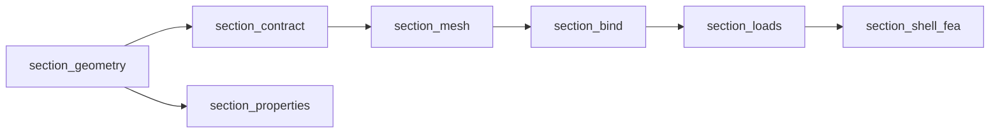
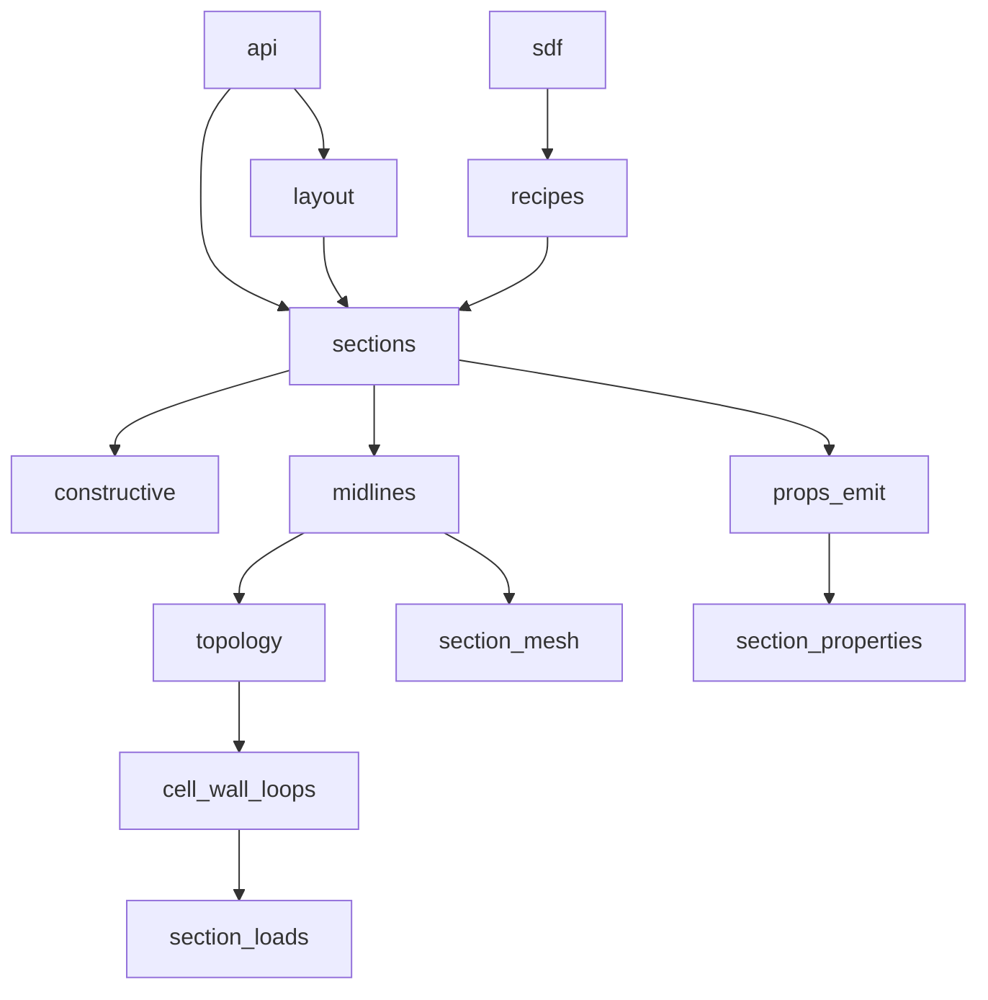
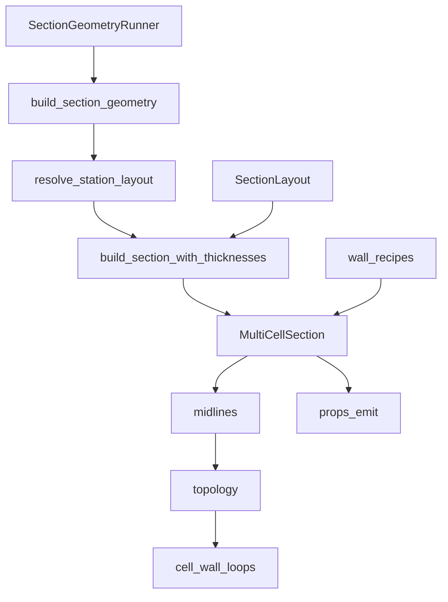

# `section_geometry`

Build a 2-D structural cross-section of a wind-turbine blade.

**Import:** `blade_structure_utilities.geometry_utilities.section_geometry`

## Table of contents

1. [Overview](#overview)
2. [Quick start](#quick-start)
3. [Learning path](#learning-path)
4. [Example figure](#example-figure)
5. [Structural systems](#structural-systems)
6. [Pipeline position](#pipeline-position)
7. [Architecture](#architecture)
8. [Concepts](#concepts)
    - [Blade-section anatomy](#blade-section-anatomy-short)
    - [Signed-distance solids](#signed-distance-solids)
    - [Layout identifiers](#layout-identifiers)
    - [Optional outputs](#optional-outputs)
    - [Coordinates](#coordinates)
9. [Package structure](#package-structure)
10. [Public API](#public-api)
11. [Results](#results)
    - [`SectionGeometryResult`](#result-sectiongeometryresult)
    - [`properties_map` entry](#result-properties-map)
    - [`ShellMidlineStrip`](#result-shellmidlinestrip)
    - [`CellWallLoop`](#result-cellwallloop)
    - [`StationLayoutResolution`](#result-stationlayoutresolution)
12. [Notes](#notes)
13. [See also](#see-also)

Docs index: [`docs/README.md`](docs/README.md).

---

## Overview

Construct a 2-D structural **section** (station cut) from an aerofoil outline, a
layout id such as `"2D-F"`, and **wall thicknesses** for the outer **skin**,
**shear webs**, and **spar caps**. The in-memory product is a set of named
planar solids; optional gates emit wall centrelines, cell-wall loops, and
per-region area / second moments.

Thicknesses are geometric only: this package is **material-bind agnostic**
(no layup, ply, or constitutive assignment). Materials enter later via
`section_bind`.

Downstream: mesh → bind → loads → FEA (`section_mesh` …); beam constitutives
in parallel via `section_properties`.

## Quick start

```python
from blade_structure_utilities.geometry_utilities.section_geometry import (
    AirfoilSDF,
    SectionGeometryRunner,
    plot_section,
    resolve_system_type,
)

layout = resolve_system_type("2D-F")
airfoil = AirfoilSDF.from_naca("2412", chord=1.0)

result = SectionGeometryRunner(
    layout=layout,
    airfoil=airfoil,
    skin_thickness=0.004,
    spar_cap_thickness=0.012,
    shear_web_thickness=0.005,
    twist_rad=0.0,
    outputs=("properties", "midlines", "cell_wall_loops"),
).execute().get_results()
```

`SectionGeometryRunner` is the public call path; `build_section_geometry` is
the test surface. Import from the package barrel. Returns
`SectionGeometryResult` or raises (e.g. `InfeasibleSectionGeometry`).

Guided paths: [`docs/guides/quickstart.md`](docs/guides/quickstart.md).
Runnable twins: [`examples/`](examples/README.md).

### Using the result

```python
# Per-region 2-D mass properties (None if "properties" was not requested)
skin_area = result.properties_map["skin_suction_surface"]["area"]

# Centreline polylines for meshing (already twisted)
for strip in result.midline_strips or ():
    print(strip.kind, strip.label, strip.midline_twisted_pitch_axis_blade_frame.shape)

# Draw the assembled section
plot_section(result.section)

# Handoff to the mesh package (requires midlines)
from blade_structure_utilities.mesh_utilities.section_mesh import (
    shell_mesh_inputs_from_geometry_result,
)
shell_inputs = shell_mesh_inputs_from_geometry_result(result)
```

To resolve which webs fit the local cavity without assembling solids:

```python
resolution = SectionGeometryRunner(
    layout=layout, airfoil=airfoil, skin_thickness=0.004,
).resolve().get_layout_resolution()
# resolution.layout          — effective SystemLayoutSpec
# resolution.dropped         — webs that did not fit
# resolution.web_x_positions_m
```

## Learning path

| Step | Where |
|------|--------|
| First station (`01`–`05`) | [`examples/`](examples/README.md) |
| Progressive recipes | [`docs/guides/quickstart.md`](docs/guides/quickstart.md) |
| All 40 layout figures | [`docs/reference/structural_systems_gallery.md`](docs/reference/structural_systems_gallery.md) |
| Labels on a `"2D-F"` figure | [`docs/guides/anatomy_on_a_figure.md`](docs/guides/anatomy_on_a_figure.md) |
| Drops / infeasible / `0A`/`0B` | [`docs/guides/feasibility_and_drops.md`](docs/guides/feasibility_and_drops.md) |
| Midlines → mesh | [`docs/guides/geometry_to_mesh.md`](docs/guides/geometry_to_mesh.md) |

## Example figure

A twin-web family-D section (layout `"2D-F"`):


Figures on this page are **generated, not checked in** —
`visualisation/output/` is gitignored, so they render locally once the gallery
demo has been run and are absent in a fresh clone. Full regen list:
[`visualisation/demos/ARTIFACTS.md`](visualisation/demos/ARTIFACTS.md).

```bash
python blade_structure_utilities/geometry_utilities/section_geometry/visualisation/demos/structural_family_grids_demo.py
python blade_structure_utilities/geometry_utilities/section_geometry/visualisation/demos/anatomy_2d_f_demo.py
```

## Structural systems

Layout keys in `SYSTEM_TYPE_KEYS` (40 entries). Pass any key to
`resolve_system_type(...)`. Pattern `{X}{Y}-{Z}` = web count · spar-cap family ·
orientation. Teasers by web count **X** (≠ spar-cap family **Y**):

| `0A` — 0 webs, no caps | `1A-F` — 1 web, no caps, flapwise | `2D-F` — 2 webs, box caps, flapwise |
|------|-------|-------|
|  |  |  |

| `3B-F` — 3 webs, single band | `4C-F` — 4 webs, discrete caps | `5A-F` — 5 webs, no caps |
|--------|-------|-------|
|  |  |  |

Full catalogue with every key:
[`docs/reference/structural_systems_gallery.md`](docs/reference/structural_systems_gallery.md).
Id decode: [`docs/reference/system_type_xyz_taxonomy.md`](docs/reference/system_type_xyz_taxonomy.md).

## Pipeline position

```text
section_geometry → section_contract → section_mesh
                                  → section_bind → section_loads → section_shell_fea
section_geometry → section_properties   (parallel; beam stiffnesses)
```



Ownership across the spine is summarised in
[`docs/COEXISTENCE_IMPLICIT_SHELL.md`](../../docs/COEXISTENCE_IMPLICIT_SHELL.md).

## Architecture

Every catalogue key builds `MultiCellSection` (N ≥ 0 webs), including `0A` /
`0B` and all `*A`–`*D` keys. Layout ids stay in `SYSTEM_TYPE_KEYS` as **named
presets**; assemble SoT is parametric `SectionLayout` + `CapPlacementRule`.
Walls are frozen recipes with three projections (SDF / polygon / midline).
Internal ownership matrix:
[`docs/reference/G_ROW_OWNERSHIP_MATRIX.md`](docs/reference/G_ROW_OWNERSHIP_MATRIX.md).



Build flow (same package, finer grain):



**Extension points**

| Extend | How |
|--------|-----|
| New layout id | Register in [`layout/system_layout.py`](layout/system_layout.py) as a `SectionLayout` preset |
| New cap/web recipe | [`recipes/`](recipes/README.md) + assemble in `MultiCellSection` |
| New optional product | Gate in `normalize_output_gates` + field on `SectionGeometryResult` + home module |
| Shape primitives | [`sdf/`](sdf/README.md) (recipe-agnostic) |

Preferred call: `SectionGeometryRunner`. Free function: `build_section_geometry`.
Assemble-only: `build_section_with_thicknesses` / `multicell_from_layout`.
Demo view: `build_section_view` (same MultiCell path).

## Concepts

### Blade-section anatomy (short)

| Term | Meaning |
|------|---------|
| **Chord** | LE → TE distance of the aerofoil |
| **LE / TE** | Leading / trailing edge |
| **SS / PS** | Suction-side / pressure-side skin partitions |
| **OML / IML** | Outer / inner mould line (contour; inward offset by skin thickness) |
| **Skin / web / spar cap** | Outer wall; wall joining upper and lower skin; thicker IML patch |
| **Cell / void** | Bay between skin and webs (closed by cell-wall loops when gated) |
| **Twist** | Geometric rotation about the pitch pivot [rad] |
| **Cavity** | Local depth for webs/caps after skin; too shallow → web drop |

Spine vocabulary: [`../../docs/CASCADE_GLOSSARY.md`](../../docs/CASCADE_GLOSSARY.md).

### Signed-distance solids

Each region is an SDF `φ(x, y)` (negative inside). CSG uses `min` / `max` for
union, intersection, difference, and offsets. The station outline is an
`AirfoilSDF`, typically `from_naca(...)`.

### Layout identifiers

A **layout** (SystemType) such as `"2D-F"` encodes **X** = web count, **Y** =
spar-cap family (`StructuralFamily` A–D), **Z** = web orientation.
`resolve_system_type` returns a frozen `SystemLayoutSpec`. On taper, webs that
do not fit the local cavity are **dropped**, not shifted
([`layout/`](layout/README.md),
[`docs/reference/system_type_xyz_taxonomy.md`](docs/reference/system_type_xyz_taxonomy.md)).

**CN** = chord-normal in the untwisted section; **F** = flapwise (vertical in
the twisted blade frame). Compare
[`2D-CN`](visualisation/output/structural_family_grids/2D-CN.png) vs
[`2D-F`](visualisation/output/structural_family_grids/2D-F.png). Full set:
[`structural systems gallery`](docs/reference/structural_systems_gallery.md).

### Optional outputs

`outputs` selects compute cost; a gate may fill more than one field:

| Requested gate | Fields filled |
|----------------|---------------|
| `"properties"` | `properties_map`, `properties_meta` |
| `"midlines"` | `midline_strips` (topology-prepared), `chord_m`, `twist_rad`, LE/TE |
| `"cell_wall_loops"` | midlines fields + `cell_wall_loops` |

Midlines are always junction-prepared before attach. Strip order is not a bind
contract. Layouts `0A` / `0B` emit skin/cap midlines for shell mesh without web
junctions; see
[`docs/reference/ADR_ZERO_WEB_SHELL_MESH.md`](docs/reference/ADR_ZERO_WEB_SHELL_MESH.md).

### Coordinates

| Layer | CASCADE name | Meaning |
|-------|--------------|---------|
| **Storage** | Storage | Kernel arrays, typically NACA-like `(x_chord, y_thickness)` |
| **Authoring / solids** | near **S** (`zero_twist_pitch_axis_station_frame`) | Untwisted IR; with host twist, SDF / `properties_map` use LE-origin rotation (rotated-NACA), not full **B** |
| **Emit midlines** | **B** (`twisted_pitch_axis_blade_frame`) | `midline_twisted_pitch_axis_blade_frame`, LE/TE via `naca_to_twisted_pitch_axis_blade_frame` |
| **Plot** | Plot | Display remap only (often Y horizontal, LE on the right) |

When twist ≠ 0, `properties_map` centroids are not in the same frame as emit
midlines. Detail: [`coordinate_frames`](../coordinate_frames/README.md) ·
[`FRAMES_INVENTORY`](../coordinate_frames/FRAMES_INVENTORY.md) ·
[`CASCADE_GLOSSARY` frames](../../docs/CASCADE_GLOSSARY.md#frames-coordinates).

## Package structure

```text
section_geometry/
├── api/            # runner and build entrypoints
├── types/          # public type aliases
├── layout/         # layout id → SystemLayoutSpec / SectionLayout
├── sdf/            # SDF primitives and AirfoilSDF
├── sections/       # MultiCellSection assembly
├── recipes/        # dual-emission wall recipes (SDF / polygon / midline)
├── constructive/   # polygons for area / inertia
├── props_emit/     # gated properties_map
├── midlines/       # centreline strip emit
├── junction_preparation/  # junction snap for meshing (topology/ alias → 2027-03-31)
├── cell_wall_loops/ # cell-wall loops
├── visualisation/  # plots and demos
└── docs/           # layout taxonomy, dual-rep notes
```

| Module | Role |
|--------|------|
| [`api/`](api/README.md) | Public lifecycle: resolve, build, return `SectionGeometryResult` |
| [`types/`](types/README.md) | Stable aliases for result types |
| [`layout/`](layout/README.md) | Catalogue ids, parametric `SectionLayout`, web-drop rules |
| [`sdf/`](sdf/README.md) | Domain-agnostic shape kernel |
| [`sections/`](sections/README.md) | Blade recipes → `MultiCellSection` ([components](sections/components/README.md)) |
| [`recipes/`](recipes/README.md) | One wall description → SDF / polygon / midline projections |
| [`constructive/`](constructive/README.md) | Polygon path for mature regions |
| [`props_emit/`](props_emit/README.md) | Orchestrates `properties_map` |
| [`midlines/`](midlines/README.md) | Wall → centreline polyline |
| [`junction_preparation/`](junction_preparation/README.md) | Snap strip endpoints for meshing |
| [`cell_wall_loops/`](cell_wall_loops/README.md) | Closed loops around empty cells |
| [`visualisation/`](visualisation/README.md) | Plotting and demos |

## Public API

Primary (use these first):

| Name | Role |
|------|------|
| `SectionGeometryRunner` | Preferred entry: construct → `resolve()` / `execute()` → `get_results()` |
| `build_section_geometry` | Free-function build (tests / scripts) |
| `resolve_system_type` | Layout string → `SystemLayoutSpec` |
| `SystemLayoutSpec` | Frozen layout configuration |
| `AirfoilSDF` | Aerofoil as an SDF |
| `MultiCellSection` | Assembled named regions |
| `SectionGeometryResult` | Worker product |
| `StationLayoutResolution` | Effective layout after web drops |
| `plot_section` | Draw an assembled section |

Also exported from the barrel (secondary):

| Name | Role |
|------|------|
| `build_section_with_thicknesses` | Assemble-only sized `MultiCellSection` (any key) |
| `build_section_view` | Demo / properties view (same MultiCell path; long thickness kwargs) |
| `multicell_from_layout` | Layout → MultiCell helper (`sections.from_layout`) |
| `section_geometry_prep_key` | Cache key for a build |
| `SYSTEM_TYPE_KEYS` | All registered layout ids |
| `SDFGrid` | Dense SDF sampling grid |
| `StructuralFamily`, `FixedCapAnchor` | Cap-family / anchor enums (**Y** axis only) |
| `parse_structural_family`, `parse_fixed_cap_anchor` | Parsers |
| `pitch_axis_x_from_le`, `max_thickness_chord_x` | Section-axis helpers |
| `SDFCallable` | Protocol for `φ(x, y)` |
| `SectionPropertiesReport`, `export_section_json` | Properties export |
| `fiber_extents_from_*`, `outer_polygon_from_airfoil`, `topology_for_section_properties` | Handoffs to `section_properties` |
| `plot_sdf_field` | Raw SDF field plot |

## Results

<a id="result-sectiongeometryresult"></a>
### `SectionGeometryResult`

| Field | Type | When | Notes |
|-------|------|------|-------|
| `section` | `SectionMidlineHost` | always | Usually a `MultiCellSection` |
| `prep_key` | `tuple` | always | Cache key |
| `properties_map` | `dict[str, dict[str, float]]` \| `None` | `"properties"` | See schema below |
| `properties_meta` | `SectionPropertiesMeta` \| `None` | `"properties"` | Backend metadata |
| `midline_strips` | `tuple[ShellMidlineStrip, ...]` \| `None` | `"midlines"` or `"cell_wall_loops"` | Topology-prepared twisted polylines |
| `cell_wall_loops` | `tuple[CellWallLoop, ...]` \| `None` | `"cell_wall_loops"` | Twisted closed loops |
| `leading_edge_twisted_pitch_axis_blade_frame`, `trailing_edge_twisted_pitch_axis_blade_frame` | `(float, float)` \| `None` | with midlines | Twisted markers [m] |
| `chord_m`, `twist_rad` | `float` \| `None` | with midlines | Shell-handoff scalars |
| `quadtree_mesh` | optional | rare | Retained QT mesh when requested |
| `stage_timings` | `dict` \| `None` | profiling | When `SECTION_GEOMETRY_PROFILE=1` |

<a id="result-properties-map"></a>
### `properties_map` entry

Each label maps to:

| Key | Unit | Meaning |
|-----|------|---------|
| `area` | m² | Region area |
| `cx`, `cy` | m | Centroid |
| `Ixx`, `Iyy`, `Ixy` | m⁴ | Second moments about the centroid |
| `r_gyr_x`, `r_gyr_y` | m | Radii of gyration |
| `label` | — | Echo of the region name |

This is per-region 2-D geometry, not beam `EA` / `EI` / `GJ`
([`section_properties`](../section_properties/README.md)).

<a id="result-shellmidlinestrip"></a>
### `ShellMidlineStrip` (from `section_contract`)

| Field | Meaning |
|-------|---------|
| `label` | Region / panel name |
| `kind` | `"skin"`, `"web"`, or `"cap"` |
| `midline_twisted_pitch_axis_blade_frame` | `(N, 2)` polyline [m], twisted |
| `thickness_m` | Wall thickness [m] |
| `skin_side` / `skin_arc` / `bay_index` | Skin panelisation metadata |
| `surface` / `alignment` | Cap surface or web alignment |

<a id="result-cellwallloop"></a>
### `CellWallLoop` (from `section_contract`)

| Field | Meaning |
|-------|---------|
| `id` | Cell index (LE → TE) |
| `polyline_twisted_pitch_axis_blade_frame` | Closed `(N, 2)` loop [m], twisted |
| `area_m2` | Shoelace area [m²] |
| `web_labels`, `piece_labels` | Bounding / construction tags |

<a id="result-stationlayoutresolution"></a>
### `StationLayoutResolution`

| Field | Meaning |
|-------|---------|
| `layout` | Effective `SystemLayoutSpec` after drops |
| `nominal_layout` | Requested layout before drops |
| `web_x_positions_m` | Surviving web x offsets [m] |
| `web_y_coords` | Matching `(y_top, y_bot)` pairs |
| `dropped` | `DroppedWeb(x_m, reason)` for each lost web |
| `stepped_down` | `True` if `layout.key != nominal_layout.key` |

## Notes

- Thickness kwargs are geometric wall gauges, not layups — materials via `section_bind`.
- This package is gauge-agnostic: it does not import `section_gauge` or
  `material_utilities`, and it does not quantise ply counts. `zone_gauges_m` is
  a one-way zone-id → wall-gauge projection; production BSP supplies it from an
  accepted `StationGaugeRealization`. Scalar skin/spar/web kwargs remain the
  non-gauge API. Geometry's legacy safety clamp remains observationally no-op
  for valid gauge-path input.
- Emit midlines are in the twisted blade frame.
- Unfittable webs appear on `StationLayoutResolution.dropped`. If no required
  web can be anchored → `InfeasibleSectionGeometry` (distinct from “too thick”).
- Sizing: resolve layout once, pass `resolution=` on later builds.
- Env: `SECTION_GEOMETRY_PROPS_BACKEND=hybrid|quadtree|grid`;
  `SECTION_GEOMETRY_PROFILE=1` → `result.stage_timings`.
- **Exactness contract (SG-008).** The aerofoil input is a discrete polygon
  (`AirfoilSDF.vertices`). Everything downstream — offsets, midlines, junctions,
  solids — is exact with respect to that polyline. Default NACA
  `n_points=200` is ~62 µm from the analytic LE at 1 m chord; that gap is
  discretisation of the generator, not a junction bug. See
  [`docs/bug_log.md`](docs/bug_log.md) SG-008 and [`sdf/README.md`](sdf/README.md).

## See also

- Module pages linked under [Package structure](#package-structure)
- [`examples/`](examples/README.md) — runnable teaching scripts `01`–`05`
- [`docs/guides/quickstart.md`](docs/guides/quickstart.md) — progressive guided paths
- [`docs/reference/structural_systems_gallery.md`](docs/reference/structural_systems_gallery.md) — all 40 layout figures
- [`docs/guides/anatomy_on_a_figure.md`](docs/guides/anatomy_on_a_figure.md) — labels / midlines / cells on a figure
- [`docs/guides/feasibility_and_drops.md`](docs/guides/feasibility_and_drops.md) — drops vs `InfeasibleSectionGeometry`
- [`docs/guides/geometry_to_mesh.md`](docs/guides/geometry_to_mesh.md) — midlines → `ShellMeshInputs`
- [`api/`](api/README.md) — caller parameters and feasibility
- [`docs/guides/caller_patterns.md`](docs/guides/caller_patterns.md) — sizing loop and spanwise webs
- [`sections/components/`](sections/components/README.md) — skin / web / cap recipes
- [`docs/`](docs/README.md) — docs index (taxonomy, patterns, gallery)
- Tests: [`tests/`](tests/README.md) —

  ```bash
  pytest blade_structure_utilities/geometry_utilities/section_geometry/tests -q
  ```

- Demos (run from repo root):

  | To see | Script |
  |--------|--------|
  | All layout families | `visualisation/demos/structural_family_grids_demo.py` |
  | Junction snap | `visualisation/demos/shell_junction_topology_demo.py` |
  | Cell-wall loops | `visualisation/demos/cell_wall_loops_demo.py` |
  | Polygon vs SDF area | `visualisation/demos/dual_rep_consistency_demo.py` |
  | Twin-web walkthrough | `visualisation/demos/naca2412_section.py` |

  Full list: [`visualisation/demos/`](visualisation/demos/README.md).
