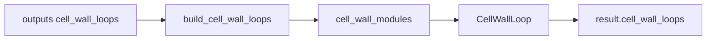

# cell_wall_loops — cell-wall loops

↑ [`section_geometry`](../README.md)

Builds closed wall loops around each inter-web cell from topology-prepared
skin and web centrelines (`CellWallLoop` in
[`section_contract`](../../section_contract/README.md)); spar caps are ignored.
With `n` webs there are exactly `n + 1` loops (one if `n = 0`).

The cells are the bounded faces of the labelled wall graph: nodes are the
skin-arc junctions made by `split_skin_at_junctions`, edges are the labelled
skin arcs and webs. No coordinate axis is read, and each loop carries
`wall_labels` — the exact strips that bound it — which consumers use as the
wall-to-cell membership ([SG-014](../docs/bug_log.md#sg-014)).

## Table of contents

1. [Organisation](#organisation)
2. [API](#api)
3. [Usage in the package](#usage-in-the-package)
4. [See also](#see-also)

---

## Organisation

| File | Role |
|------|------|
| `cell_wall_loops.py` | `build_cell_wall_loops` |
| `cell_wall_loop_builders.py` | Face walk over the labelled wall graph; invariant checks |
| `cell_wall_geom.py` | Skin-ring ordering, shoelace area |

## API

| Name | File | Role |
|------|------|------|
| `build_cell_wall_loops` | `cell_wall_loops.py` | Strips → loops |

Raises `ValueError` when the walls are not a planar subdivision of the skin
ring: a web end not on a skin junction (to 1 nm — webs are never
extrapolated), two webs on one junction, crossing webs, a skin that does not
chain, or cell areas that do not tile the ring.

`CellWallLoop` fields (`id`, `polyline_twisted_pitch_axis_blade_frame`,
`area_m2`, …) are summarised in
[`../README.md` § Results](../README.md#cellwallloop-from-section_contract).

## Usage in the package

Gated by `outputs` including `"cell_wall_loops"`, which implies midline
extraction. Result field is always `cell_wall_loops`. Prefer
topology-prepared strips as input. Zero-web stations emit a single enclosed
cavity loop ([`ADR_ZERO_WEB_SHELL_MESH`](../docs/reference/ADR_ZERO_WEB_SHELL_MESH.md)).

## See also

- [`../topology/`](../topology/README.md)
- [`../../section_contract/`](../../section_contract/README.md)
