# section_geometry docs

Guides and reference (overview: package README).

↑ [`section_geometry`](../README.md)

## Table of contents

1. [Directory map](#directory-map)
2. [Doc map](#doc-map)
3. [Examples](#examples)
4. [Guides](#guides)
5. [Reference](#reference)
6. [Reports](#reports)
7. [Module pages](#module-pages)

---

## Directory map

- `guides/` — task-oriented walkthroughs: how to call the package and what to do next.
- `reference/` — what the identifiers and layouts *are*; look-up material.
- `reports/` — engineering records: acceptance narratives and performance findings.
- `presentation/` — presentation pages (L2 presentation location).
- `bug_log.md` — required at this level by
  [`DOCUMENTATION_STANDARDS`](../../../../../docs/conventions/documentation/DOCUMENTATION_STANDARDS.md);
  do not move it into a subdirectory.

## Doc map

```mermaid
flowchart TB
  PkgReadme[package_README] --> Guides[guides]
  PkgReadme --> Examples[examples_scripts]
  PkgReadme --> Reference[reference]
  PkgReadme --> Reports[reports]
  PkgReadme --> Modules[module_READMEs]
  Guides --> Quickstart[quickstart]
  Guides --> Patterns[caller_patterns]
  Guides --> Anatomy[anatomy_on_a_figure]
  Guides --> Feas[feasibility_and_drops]
  Guides --> Handoff[geometry_to_mesh]
  Reference --> GMatrix[G_ROW_OWNERSHIP_MATRIX]
  Reference --> Taxonomy[system_type_xyz_taxonomy]
  Reference --> Gallery[structural_systems_gallery]
  Reports --> DualRep[DUAL_REP_ACCEPTANCE]
  Reports --> Perf[PERFORMANCE_WORK_SUMMARY]
  Examples --> Quickstart
  Examples --> Handoff
  Modules --> Api[api]
  Modules --> Layout[layout]
  Modules --> Sections[sections]
  Modules --> Mid[midlines]
  Modules --> CellWall[cell_wall_loops]
  Modules --> PropsEmit[props_emit]
```

## Examples

Runnable teaching scripts (not plot demos):

| Path | Role |
|------|------|
| [`../examples/`](../examples/README.md) | `01`–`05` newcomer path: first station → properties → resolve/size → spanwise anchors → mesh handoff |
| [`../visualisation/demos/`](../visualisation/demos/README.md) | Figure generation / gallery regeneration |

## Guides

| Doc | Contents |
|-----|----------|
| [`guides/quickstart.md`](guides/quickstart.md) | Progressive paths: first call → result → layout → sizing → spanwise webs |
| [`guides/caller_patterns.md`](guides/caller_patterns.md) | Simple build, sizing loop, spanwise webs |
| [`guides/anatomy_on_a_figure.md`](guides/anatomy_on_a_figure.md) | Labels / midlines / cells on a `"2D-F"` figure |
| [`guides/feasibility_and_drops.md`](guides/feasibility_and_drops.md) | `InfeasibleSectionGeometry` vs dropped webs; `0A`/`0B` handoff |
| [`guides/geometry_to_mesh.md`](guides/geometry_to_mesh.md) | Midlines → `ShellMeshInputs` → `section_mesh` |

## Reference

| Doc | Contents |
|-----|----------|
| [`reference/G_ROW_OWNERSHIP_MATRIX.md`](reference/G_ROW_OWNERSHIP_MATRIX.md) | Internal G-row ownership matrix (PHASE7A analogue) |
| [`reference/system_type_xyz_taxonomy.md`](reference/system_type_xyz_taxonomy.md) | Layout-id decode (`"2D-F"` → web count, cap family, orientation) |
| [`reference/structural_systems_gallery.md`](reference/structural_systems_gallery.md) | All 40 `SYSTEM_TYPE_KEYS` with demo figures |
| [`reference/ADR_ZERO_WEB_SHELL_MESH.md`](reference/ADR_ZERO_WEB_SHELL_MESH.md) | `0A`/`0B` shell-mesh handoff (N = 0 strips) |

## Reports

| Doc | Contents |
|-----|----------|
| [`reports/DUAL_REP_ACCEPTANCE.md`](reports/DUAL_REP_ACCEPTANCE.md) | Polygon vs SDF area acceptance |
| [`reports/PERFORMANCE_WORK_SUMMARY.md`](reports/PERFORMANCE_WORK_SUMMARY.md) | Hybrid / quadtree performance notes |
| [`reports/SG009_JUNCTION_PRIMITIVES_SPIKE.md`](reports/SG009_JUNCTION_PRIMITIVES_SPIKE.md) | SG-009 design spike — post-resample axis×cap junctions |
| [`bug_log.md`](bug_log.md) | Debug log — junction/tolerance findings and the standing invariant |

## Module pages

| Module | Topic |
|--------|-------|
| [`../api/`](../api/README.md) | Public runner, caller parameters, feasibility |
| [`../tests/`](../tests/README.md) | How to run the package tests |
| [`../layout/`](../layout/README.md) | Layout ids and web cascade |
| [`../sdf/`](../sdf/README.md) | Shape kernel |
| [`../sections/`](../sections/README.md) | `MultiCellSection` |
| [`../sections/components/`](../sections/components/README.md) | Skin / web / cap / core recipes |
| [`../recipes/`](../recipes/README.md) | Dual-emission wall recipes |
| [`../constructive/`](../constructive/README.md) | Polygons for area |
| [`../props_emit/`](../props_emit/README.md) | `properties_map` |
| [`../midlines/`](../midlines/README.md) | Centreline strips |
| [`../junction_preparation/`](../junction_preparation/README.md) | Junction snap |
| [`../cell_wall_loops/`](../cell_wall_loops/README.md) | Cell-wall loops |
| [`../examples/`](../examples/README.md) | Teaching scripts `01`–`05` |
| [`../visualisation/demos/`](../visualisation/demos/README.md) | Demo run list |
