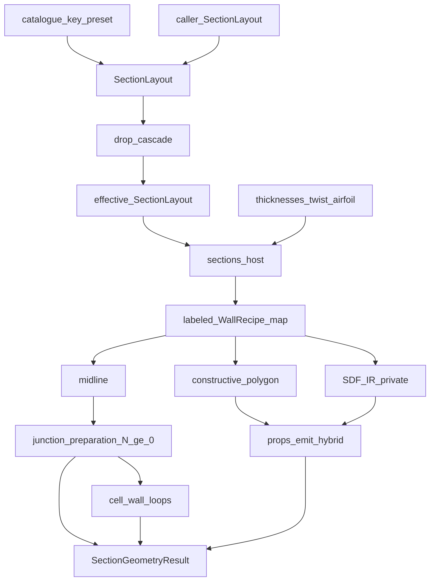

# G-row ownership matrix — `section_geometry`

Internal analogue of the section_selection PHASE7A layer matrix. Domain row
IDs, not software layers. `api` is the only sequencer; skip-layer imports are
defects.

↑ [`docs index`](../README.md) · [`section_geometry`](../../README.md) ·
outer contract:
[`package_boundaries.md`](../../../../../blade_structure_precompute/module/section_selection/docs/package_boundaries.md) ·
[`COEXISTENCE_IMPLICIT_SHELL.md`](../../../../docs/COEXISTENCE_IMPLICIT_SHELL.md)

## Table of contents

1. [Outer contract](#1-outer-contract)
2. [Target model](#2-target-model)
3. [Ownership matrix](#3-ownership-matrix)
4. [Forbidden internal leaks](#4-forbidden-internal-leaks)
5. [Package map](#5-package-map)
6. [See also](#6-see-also)

---

## 1. Outer contract

Do not reopen these worker boundaries:

| | |
|---|---|
| **Product** | `SectionGeometryResult` via `SectionGeometryRunner` from L4-EVAL only |
| **Owns** | SDF/CSG, midlines in frame **B**, gated `properties_map`, `cell_wall_loops` |
| **Must not own** | Mesh density / Q4 / +x3; true laminates / layup (`section_bind` / `section_layup` / `section_schedule`); SFV; FI; campaign Sets / `StationTask` |
| **DTO sibling** | `section_contract` stays types-only |
| **Banned top-level homes** | `engine/`, `interface/`, `core/`, and any new `projections/` mega-home |

Dual-rep carve-out: SDF defines the solid; constructive polygons are the mature
integration path. Unify the **description they share** (recipes), not the
representations themselves.

Public barrel symbols stay: `SectionGeometryRunner`, `SectionGeometryResult`,
`MultiCellSection`, `AirfoilSDF`, `resolve_system_type` / `SYSTEM_TYPE_KEYS`,
`SectionLayout`.

## 2. Target model

A station is not a catalogue letter. It is:

1. **Policy** — parametric `SectionLayout` (web stations or axes, orientation,
   `CapPlacementRule`).
2. **DVs** — geometric thicknesses + twist + airfoil.
3. **Walls** — labeled map of frozen recipes (`SkinWall`, `WebWall`, `CapWall`,
   `CoreWall`, `InsertWall`).
4. **Projections** — each recipe yields SDF IR, boundary polygon, and midline
   (cores/inserts skip midline).
5. **Graph** — junction preparation and cell-wall loops on the strip set; `N`
   webs including `N = 0`. Mesh density remains in `section_mesh`.

`SYSTEM_TYPE_KEYS` / `SystemLayoutSpec` are **named presets** that construct a
`SectionLayout`. Family A–D is a `CapPlacementRule`, not an assemble switch.
`0A`/`0B` are `n_webs = 0` plus cap rule, not a second host
([`ADR_ZERO_WEB_SHELL_MESH.md`](ADR_ZERO_WEB_SHELL_MESH.md)).



## 3. Ownership matrix

| Row | Home | Owns | May call | Forbidden imports | Primary output |
|-----|------|------|----------|-------------------|----------------|
| `G-API` | [`api/`](../../api/README.md) | Runner lifecycle, validation, gated packaging | `G-LAYOUT`, `G-ASSEMBLE`, emit homes | SDF algebra, mesh, bind, FE | `SectionGeometryResult` |
| `G-LAYOUT` | [`layout/`](../../layout/README.md) | `SectionLayout` SoT, catalogue presets, drop cascade, `CapPlacementRule` | `AirfoilSDF` cavity queries | recipes, components, constructive, junction_preparation | effective `SectionLayout` / `StationLayoutResolution` |
| `G-RECIPE` | [`recipes/`](../../recipes/README.md) | Frozen wall parameters; the three projection methods | `G-SDF` kernel, `G-POLY` emitters, `G-MID` helpers | layout cascade, junction_preparation, props_emit, api | `SkinWall` / `WebWall` / `CapWall` / `CoreWall` / `InsertWall` |
| `G-ASSEMBLE` | [`sections/`](../../sections/README.md) | Host: layout + DVs → labeled recipe map + SDF eval cache | layout, recipes, sdf | junction_preparation, cell_wall_loops, props_emit, mesh | `MultiCellSection` |
| `G-SDF` | [`sdf/`](../../sdf/README.md) | CSG primitives, IR, `AirfoilSDF` | nothing blade-specific | recipes, sections, layout | `φ`, `Expr` |
| `G-POLY` | [`constructive/`](../../constructive/README.md) | Polygon projection of recipes; offset_locus / shoelace | recipes | midlines, junction_preparation, layout | region polygons |
| `G-MID` | [`midlines/`](../../midlines/README.md) | Centreline projection of recipes; contract strips in **B** | recipes, `section_contract` | constructive, sdf, props_emit, mesh density | `ShellMidlineStrip` |
| `G-TOPO` | [`junction_preparation/`](../../junction_preparation/README.md) | Junction preparation on strips; `N ≥ 0` | midlines | sdf, constructive, recipes, layout | prepared strips |
| `G-LOOP` | [`cell_wall_loops/`](../../cell_wall_loops/README.md) | Closed loops from prepared strips | junction_preparation output | sdf, constructive, recipes | `CellWallLoop` |
| `G-PROPS` | [`props_emit/`](../../props_emit/README.md) | Gated `properties_map` (hybrid) | constructive, sdf residual | junction_preparation, midlines, bind, `section_properties` beam math | `properties_map` |

`types/` re-exports product aliases only. Consumers (including L4-EVAL) import
the **barrel / runner**; deep homes are maintainer-internal.

## 4. Forbidden internal leaks

- No second wall description. Components are not independently authorable.
  Production must not call `from_component`, `_cap_recipes_from_assembled`, or
  `_cap_from_components`.
- No catalogue-letter assemble. Cap placement is `CapPlacementRule` → `CapWall`
  recipes.
- No web-assuming junction preparation. Empty web set is valid.
- No mesh product on the geometry result. `retain_mesh` / quadtree artefacts are
  **G-PROPS debug** (hybrid/quadtree occupancy), not `section_mesh`. Import QT
  helpers from `props_emit`, not the package barrel.
- No layup vocabulary for wall solids (`emit_wall_solid_*`, `is_wall_solid_label`;
  no `emit_laminate_*` / `is_laminate_label` / `laminates_for_core`).
- No `void_cell_*` public names; implementation matches the `cell_wall_loops`
  product.
- No skip-layer: junction_preparation does not import sdf; constructive does not
  rebuild from host component attrs; layout does not import sections.
- `compute_section_properties` is not an L4 executable seam — properties are a
  gated runner output.

Frames: solids authored untwisted; emit midlines/loops in **B**;
`properties_map` stays in the authoring frame; campaign remaps stay in
orchestration.

## 5. Package map

```text
section_geometry/
  api/                 # runner, resolve, result packaging
  types/               # public aliases / product DTOs
  layout/              # SectionLayout SoT, presets, drop, CapPlacementRule
  sdf/                 # kernel only
  recipes/             # wall params + projection dispatch
    walls.py
    sdf_ir/            # private SDF IR (former sections/components)
  sections/            # assemble + host only (no public component types)
  constructive/        # polygon projection
  midlines/            # centreline projection
  junction_preparation/  # strip junctions, N≥0 (topology/ is alias until 2027-03-31)
  cell_wall_loops/     # from prepared strips
  props_emit/          # hybrid properties_map
  profiling.py         # cross-cutting timers (not under sdf/)
  visualisation/ docs/ examples/ tests/
```

`constructive/` and `midlines/` stay separate domain homes (area vs mesh
products). Unification is shared **input** (recipes), not a collapsed folder.
`MultiCellSection` remains the host name (`N ≥ 0`).

## 6. See also

- [`ADR_ZERO_WEB_SHELL_MESH.md`](ADR_ZERO_WEB_SHELL_MESH.md) — zero-web shell handoff
- [`system_type_xyz_taxonomy.md`](system_type_xyz_taxonomy.md) — catalogue decode
- [`../reports/DUAL_REP_ACCEPTANCE.md`](../reports/DUAL_REP_ACCEPTANCE.md) — polygon vs SDF
- Module READMEs under [`../README.md`](../README.md) module pages
