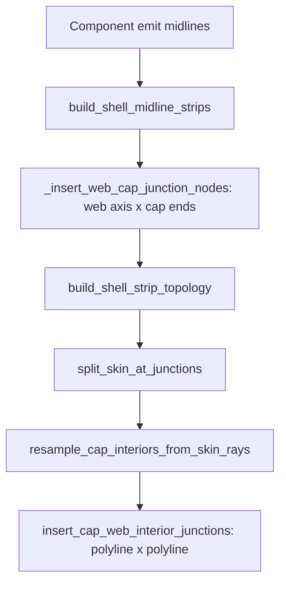

# SG-009 — junction primitives design spike

Design spike + migration note. The production rewrite landed 2026-08-30:
`insert_cap_web_interior_junctions` now uses post-resample web-axis x final-cap
solves (`intersect_web_axis_open_polyline_2d`). Bug status: **Fixed**
([`bug_log` SG-009](../bug_log.md#sg-009)).

↑ [`docs index`](../README.md) · [`bug_log` SG-009](../bug_log.md#sg-009) ·
[`section_geometry`](../../README.md)

## Table of contents

1. [Problem](#problem)
2. [Current flow](#current-flow)
3. [Chosen direction](#chosen-direction)
4. [Proposed API shape](#proposed-api-shape)
5. [Tangency and test-oracle rules](#tangency-and-test-oracle-rules)
6. [Migration sketch (landed)](#migration-sketch-landed)
7. [Offline prototype](#offline-prototype)
8. [Non-goals](#non-goals)

---

## Problem

Interior cap–web T-junctions are still recovered from **sampled polylines** via
`intersect_open_polylines_2d` in
[`topology/cap_web_junctions.py`](../../topology/cap_web_junctions.py)
after skin-ray resample. Making a junction exact turns a crossing into a
tangency, so the production detector cannot verify its own work (SG-005 /
SG-009). Cap-end and web-foot junctions already solve from primitives (SG-004 /
SG-002); interiors do not.

## Current flow



| Step | Function | Role |
|------|----------|------|
| Web foot | `ShearWeb.midline_polyline` → `_extend_to_skin_mid_surface` | Axis × skin mid-surface at emit (SG-002) |
| Cap **end** | `shell_midline_export._insert_web_cap_junction_nodes` | Axis × cap; web vertices at cap ends only (SG-004) |
| Skin index | `split_skin_at_junctions` | Indexes web feet; caps untouched |
| Cap interior | `resample_cap_interiors_from_skin_rays` | Rebuilds cap interiors — **destroys** any earlier cap vertices |
| Cap **interior** | `insert_cap_web_interior_junctions` | `intersect_open_polylines_2d` on final polylines; insert shared `p` into both strips (SG-005) |

**Why interiors cannot close at emit under current resample.** Any cap-side node
inserted before ray resample is discarded when the cap interior is rebuilt.
Closing the **web** side at emit turns the later polyline crossing into a
tangency, so the production detector finds nothing on the cap (`4D-F` swap in
SG-005). Detection must therefore run against the **final** cap polyline, after
resample.

## Chosen direction

**Post-resample web-axis × final-cap solve**, then insert the same point into
both strips.

Rationale:

- The discriminating test already locates crossings this way
  (`_axis_crossings` in `test_cap_web_interior_junction_shared_node.py`).
- It respects today’s order in `build_shell_strip_topology` (split → resample →
  interior).
- It generalises SG-002 / SG-004 (solve from the web axis) without requiring a
  rewrite of ray resample to “sample through” precomputed junction parameters.
- Polygon contract (SG-008) is settled: the axis and the final cap polyline are
  both defined on the discrete section; no analytic-NACA budget is needed.

Pre-sample “analytic offset ring × axis, then sample both strips through `p`”
remains a longer-term option, but it forces ray resample to preserve junction
seeds and is out of scope for the first rewrite.

## Proposed API shape

```text
solve_interior_cap_web_junctions(strips) -> strips'
  for each web strip W with axis (W[0] → W[-1]):
    for each final cap polyline C:
      for each interior hit p = axis ∩ C  (exclude cap endpoints):
        insert p into C and into W  (same point; no projection)
```

Reuse today’s helpers:

- Insertion without relocating geometry: `_insert_points_on_segments` /
  pending-web commit in `insert_cap_web_interior_junctions`.
- Half-junction guard: only queue a web node if the cap still carries `p`.

The production detector `intersect_open_polylines_2d` becomes unnecessary for
topology truth; it may remain for tools and demos.

## Tangency and test-oracle rules

| Rule | Why |
|------|-----|
| Never detect after inserting a shared node on the same pass’s inputs without holding detections first | Tangency trap (SG-005) |
| Discriminating tests use an **independent** oracle (web axis × cap), not `intersect_open_polylines_2d` | Detector returns 0 on correct prepared strips — identical to “deleted every junction” |
| Cap-end junctions stay at emit on the web only | Cap interiors are rebuilt afterwards |
| Default path does not flip in this spike | Spike is design + offline check only |

## Migration sketch (landed)

1. Replaced the `intersect_open_polylines_2d` loop in
   `insert_cap_web_interior_junctions` with `intersect_web_axis_open_polyline_2d`
   on the post-resample strips (same insertion / pending-web machinery).
2. Kept `_insert_web_cap_junction_nodes` for cap **ends** at emit.
3. Left `intersect_open_polylines_2d` exported for measurement tools; tests use
   the axis x cap primitive as the existence oracle.
4. Gated on shared-node / web-foot / shell-strip fidelity; no BL-014 work.

## Offline prototype

Non-production script:

[`visualisation/demos/sg009_axis_cap_junction_spike.py`](../../visualisation/demos/sg009_axis_cap_junction_spike.py)

For layouts `4D-F` (tangency stress) and `5C-CN` (short-cap / SG-007 stress):

1. Run production emit + topology.
2. Re-solve interiors via web axis × final cap (the proposed oracle).
3. Report max distance from each oracle hit to the nearest production web and
   cap vertex (expect ~0 nm after SG-005 / SG-007).

Does **not** wire into `build_shell_strip_topology`.

```bash
python blade_structure_utilities/geometry_utilities/section_geometry/visualisation/demos/sg009_axis_cap_junction_spike.py
```

## Non-goals

- No BL-014 triage (tied-web Hashin FI).
- No analytic-NACA LE `n_points` budget (SG-008 reading 2 stays rejected;
  polygon is the contract).
- No pre-sample analytic offset-ring x axis (longer-term; still out of scope).
