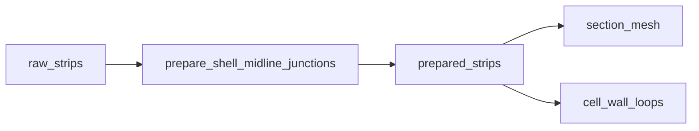

# junction_preparation — index strip junctions for meshing.

↑ [`section_geometry`](../README.md)

Indexes already-emitted twisted strips so web–skin and cap–web junctions share
coincident endpoints for meshing. Splits skin arcs at web-foot arc lengths and
inserts cap–web T-junctions where required. **Does not relocate web feet** —
feet must land on the skin mid-surface at emit (SG-002 /
``ShearWeb._extend_to_skin_mid_surface``). Prepared strips differ from raw emit
only by indexing / node insertion; `cell_wall_loops` and mesh consumers should
use the prepared form.

Historic package path ``section_geometry.topology`` is a DeprecationWarning
alias until 2027-03-31.

## Organisation

| File | Role |
|------|------|
| `shell_midline_junction_preparation.py` | Main index / panelise pass |
| `cap_web_junctions.py` | Cap–web T-junction insert (axis × final cap) |
| `cap_skin_bonds.py` | Cap–skin vertex correspondence (TW-001) |
| `../midlines/junction_primitives.py` | Shared axis × offset-ring oracle; production web feet use it at emit |
| `../midlines/cap_skin_ray_resample.py` | Cap ray resample; preserves pre-resample junction seeds |

## API

| Name | File | Role |
|------|------|------|
| `prepare_shell_midline_junctions` | `shell_midline_junction_preparation.py` | Raw → prepared strips |
| `ShellMidlineJunctionPreparationOptions` | `shell_midline_junction_preparation.py` | Tolerances / options |

## Usage in the package

## See also

- [`../midlines/`](../midlines/README.md)
- [`../cell_wall_loops/`](../cell_wall_loops/README.md)
