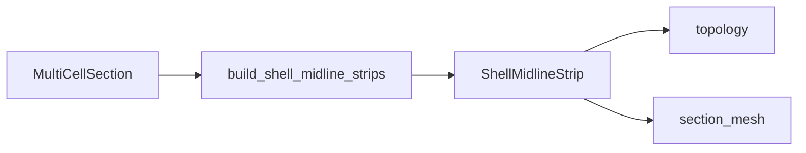

# midlines — centreline strip emit

↑ [`section_geometry`](../README.md)

Emits wall centrelines as `(N, 2)` polylines (`ShellMidlineStrip`: `skin` /
`web` / `cap`) from component recipes, then applies geometric twist once into
the blade frame ([`section_contract`](../../section_contract/README.md)).
Mid-loci follow the recipe (aerofoil offset, web capsule axis, IML offset),
not post-boolean SDF zero contours.

## Table of contents

1. [Organisation](#organisation)
2. [API](#api)
3. [Usage in the package](#usage-in-the-package)
4. [See also](#see-also)

---

## Organisation

| File | Role |
|------|------|
| `shell_midline_export.py` | `build_shell_midline_strips` |
| `section_midline_host.py` | Host protocol |
| `skin_split.py` | Split skin arcs at junctions |
| `cap_skin_ray_resample.py` | Cap–skin resampling |
| `ring_geometry.py` | Closed-ring helpers |

## API

| Name | File | Role |
|------|------|------|
| `build_shell_midline_strips` | `shell_midline_export.py` | Section → twisted strips |
| `SectionMidlineHost` | `section_midline_host.py` | Protocol |
| `split_skin_at_junctions` | `skin_split.py` | Panelise skin |

`ShellMidlineStrip` fields (`label`, `kind`,
`midline_twisted_pitch_axis_blade_frame`, `thickness_m`, …)
are summarised in [`../README.md` § Results](../README.md#shellmidlinestrip-from-section_contract)
and defined in [`../../section_contract/`](../../section_contract/README.md).

## Usage in the package

Do not apply a second twist to `midline_twisted_pitch_axis_blade_frame`.

## See also

- [`../junction_preparation/`](../junction_preparation/README.md)
- [`../../section_contract/`](../../section_contract/README.md)
