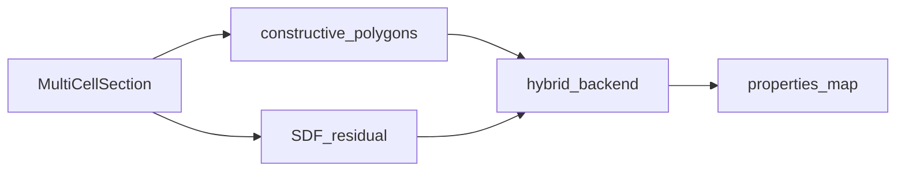

# props_emit — per-region geometric properties

↑ [`section_geometry`](../README.md)

When `outputs` includes `"properties"`, builds `properties_map`: per-region
2-D mass properties (area, centroid, second moments). Default backend is
**hybrid** (constructive polygons for mature labels including LE/TE inserts;
adaptive SDF sampling only for any remaining residual labels). Beam `EA` /
`EI` / `GJ` belong to
[`section_properties`](../../section_properties/README.md).

## Table of contents

1. [Organisation](#organisation)
2. [API](#api)
3. [Usage in the package](#usage-in-the-package)
4. [See also](#see-also)

---

## Organisation

| File | Role |
|------|------|
| `props_compute.py` | `compute_section_properties` |
| `props_backend.py` | Backend selection / environment defaults |
| `area_mesh.py` | Quadtree adapter |
| `section_evaluator.py` | Evaluate SDF labels over a mesh |
| `props_handoff.py` | Helpers for `section_properties` |
| `export.py`, `export_section_json.py` | Reports and JSON |
| `properties_report.py` | Report wrapper |
| `plot.py` | Property plot helpers |

## API

| Name | File | Role |
|------|------|------|
| `compute_section_properties` | `props_compute.py` | Main entry → map + metadata |
| `props_backend_from_env` | `props_backend.py` | Default backend |
| `topology_for_section_properties` | `props_handoff.py` | Peer handoff |
| `SectionPropertiesReport` | `export.py` | Exportable report |

Per-label keys (`area`, `cx`, `cy`, `Ixx`, `Iyy`, `Ixy`, …) are listed in
[`../README.md` § Results](../README.md#properties_map-entry).

## Usage in the package

Called from `build_section_geometry` when `"properties"` is gated; stored on
`SectionGeometryResult.properties_map`. Moments and centroids are in the
solids’ **authoring frame as built** (with host twist: LE-origin rotated-NACA).
That is **not** frame **B** (`twisted_pitch_axis_blade_frame`); do not silently
re-twist the map to match emit midlines.

## See also

- [`../constructive/`](../constructive/README.md)
- [`../../section_properties/README.md`](../../section_properties/README.md)
