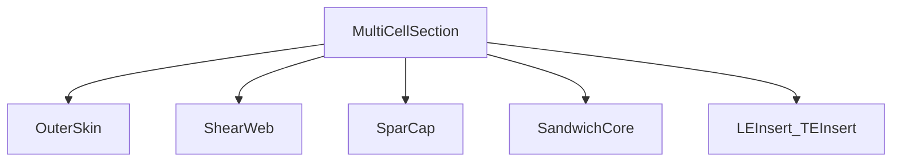

# components — structural part recipes

↑ [`sections`](../README.md) · [`section_geometry`](../../README.md)

Named SDF regions and midline recipes assembled by `MultiCellSection` from
layout and wall thicknesses. OML is `{φ_af = 0}`; IML is the inward skin
offset; skin is an inward slab from the OML, caps sit on the IML, cores fill
the residual cavity. No material / layup policy here.

## Table of contents

1. [Outer and inner mould lines](#outer-and-inner-mould-lines)
2. [Components](#components)
3. [Organisation](#organisation)
4. [See also](#see-also)

---

## Outer and inner mould lines

- **OML:** aerofoil contour `{φ_af = 0}`.
- **IML:** inward offset by `skin_thickness` (cavity boundary after the skin slab).

Skin is an inward slab from the OML. Spar caps sit on the IML. Cores fill the
cavity minus wall solids (skin / webs / caps).

## Components

| Class | File | Solid | Typical labels |
|-------|------|-------|----------------|
| `OuterSkin` | `outer_skin.py` | Slab from OML, often split suction/pressure | `skin_suction_surface`, `skin_pressure_surface` |
| `ShearWeb` | `shear_web.py` | Capsule axis ∩ inner cavity | `shear_web_0`, `shear_web_1`, … |
| `SparCap` | `spar_cap.py` | Slab on IML, clipped to a chord band | `spar_cap_suction_surface`, `spar_cap_pressure_surface` |
| `SandwichCore` | `sandwich_core.py` | Cavity − wall solids ∩ bay clip | `sandwich_core_0`, … |
| `LEInsert` / `TEInsert` | `inserts.py` | Residual tip solids (SDF path for props) | `leading_edge_insert`, `trailing_edge_insert` |

**Suction / pressure:** camber-upper and camber-lower skin partitions. Midlines
for skin are the geometric mid-locus (`buffer(-t/2)` of the aerofoil polygon),
split into open suction/pressure arcs (and later leading_edge / bay /
trailing_edge panels in topology).

**Webs:** constant-thickness shell around a capsule between skin anchors;
alignment is `"chord_normal"` or `"flapwise"`.

**Caps:** flush against the IML; family A–D placement is decided in
[`../build_spar_caps.py`](../build_spar_caps.py) / [`../spar_family.py`](../spar_family.py).

**Cores:** inside the IML, outside skin/web/cap solids, clipped to a bay
between webs.

**Inserts:** tip solids; props use the constructive polygon path by default
([`../../docs/reports/DUAL_REP_ACCEPTANCE.md`](../../docs/reports/DUAL_REP_ACCEPTANCE.md),
[`../../recipes/`](../../recipes/README.md)).

## Organisation

| File | Role |
|------|------|
| `base.py` | `SectionComponent` base / twist helpers |
| `outer_skin.py` | Skin slab + mid-ring |
| `shear_web.py` | Web capsule |
| `spar_cap.py` | Cap slab |
| `sandwich_core.py` | Core bay |
| `inserts.py` | LE/TE inserts |
| `__init__.py` | Re-exports |

## See also

- [`../README.md`](../README.md) — `MultiCellSection` assembly
- [`../labels.py`](../labels.py) — `ComponentLabel`
- [`../../midlines/`](../../midlines/README.md) — strip emit from recipes
